<p align="center">
  <picture>
    <source media="(prefers-color-scheme: dark)" srcset="package/docs/images/readme-banner-dark.svg">
    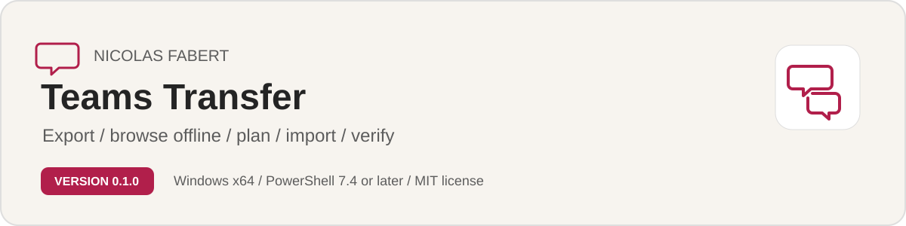
  </picture>
</p>

<p align="center">
  <a href="#get-started"><b>Get started</b></a> &nbsp;&middot;&nbsp;
  <a href="#how-it-works"><b>How it works</b></a> &nbsp;&middot;&nbsp;
  <a href="#console"><b>Console</b></a> &nbsp;&middot;&nbsp;
  <a href="#reports"><b>Reports</b></a> &nbsp;&middot;&nbsp;
  <a href="#requirements"><b>Requirements</b></a> &nbsp;&middot;&nbsp;
  <a href="#quick-start"><b>Quick start</b></a> &nbsp;&middot;&nbsp;
  <a href="package/docs/TeamsTransfer-UserGuide.md"><b>User guide</b></a> &nbsp;&middot;&nbsp;
  <a href="package/docs/TeamsTransfer-Guide.md"><b>Reference guide</b></a>
</p>

<p align="center">
  <a href="https://github.com/Nico77600/TeamsTransfer/releases/latest"></a>
</p>

**Author: Nicolas Fabert (Nico77600)**<br>
**Version 1.0.0** ([changelog](package/CHANGELOG.md)) &middot; MIT license

> [!TIP]
> **Download the latest release.** Open the [latest release](https://github.com/Nico77600/TeamsTransfer/releases/latest) and download **`TeamsTransfer-1.0.0-win-x64.zip`** under *Assets* (its SHA-256 is in the release notes). That ZIP is the signed tool, with the HTML guides. Do not use the **Source code** archives or the green **Code** button: they are a copy of the repository, not the release package.

> [!IMPORTANT]
> Windows marks files downloaded from the Internet. After you extract the ZIP, check the publisher first (right-click `Invoke-TeamsTransfer.ps1`, Properties, Digital Signatures: `Nicolas Fabert`), then unblock the extracted folder once:
>
> ```powershell
> Get-ChildItem "D:\Tools\TeamsTransfer-1.0.0" -Recurse -File -Force | Unblock-File
> ```
>
> Replace the example path with the folder the ZIP created. A release package is verified before anything runs; a source checkout starts only with `-DevelopmentMode`.

> [!IMPORTANT]
> **Teams Transfer requires PowerShell 7.4 or later (`pwsh.exe`).** Windows PowerShell 5.1 is refused before any code runs. PowerShell 7 is not bundled in the release: install it once with `winget install Microsoft.PowerShell`.

## Why

Teams Transfer exports Microsoft Teams **chats and channels** (messages, reactions, images, files) from a tenant into a verified local store, lets you read them **offline in a Teams-like archive**, and **imports them into a tenant** with the Microsoft Graph Teams migration API, in lots and in waves, with a ghost account for every deleted author and a verification at the end. A guided Windows console for the person who does not want to type commands, a PowerShell 7 command line for the rest.

Moving Teams conversations between tenants is not a copy: the service has no export for chats and channels, an author who left the company cannot be named in the target, and an import is slow and cannot be undone. Teams Transfer is made for that long, careful job.

- **You see before you write.** Every mode that writes to a tenant is a preview unless you add `-Apply`. The plan says where each conversation goes, who writes it, which files are copied, what blocks and how long it will take.
- **Nothing is lost on the way.** Messages, reactions, images and files go to a local store that is checked and de-duplicated. What you do not re-import stays readable in an offline archive.
- **The original author is kept.** A person deleted at the source gets one disabled, unlicensed ghost account in the target, the same one for the whole project.
- **A long job survives.** A journal makes every run resumable and idempotent: run the same command again and only what is left is done, a message is never sent twice.
- **The result is verified.** The target is read back chat by chat and compared with the journal and the source.

> [!CAUTION]
> Imported messages cannot be rolled back, and the import of several years of history takes weeks or months because of the limits of the service. Run every write mode as a preview, read the plan, and test in a lab tenant before you use real data. See the [Disclaimer](#disclaimer).

## Get started

One path for everyone. Set the tool up once (**1 to 4**), then take task **A** to export and read offline, **B** to import into a tenant, or both. The commands use one example: the ZIP extracted in `D:\Tools` (it creates `D:\Tools\TeamsTransfer-1.0.0`) and the store in `D:\ttstore`. Change only these folders to yours. The [user guide](package/docs/TeamsTransfer-UserGuide.md) explains each step with a picture, what you should see and what to do if not, in plain words.

### Set up once &middot; 1 to 4

```powershell
# 1 · Get your rights. Give your administrator the section "Requirements" below and chapter 2 of the user guide:
#     one app registration per side, with a certificate (a read-only source app, a target app that writes).

# 2 · On the PC, in PowerShell 7.4+: download TeamsTransfer-1.0.0-win-x64.zip from the latest release
#     (under Assets, not Source code), extract it to D:\Tools, then unblock the folder it created.
Get-ChildItem D:\Tools\TeamsTransfer-1.0.0 -Recurse -File -Force | Unblock-File

# 3 · Write your tenant ids, application ids and certificate thumbprints in the file you create
#     (the user guide, chapter 3, shows how; the console also shows what is missing).
notepad D:\Tools\TeamsTransfer-1.0.0\config\TeamsTransfer.config.local.psd1

# 4 · Open the console: double-click Start-TeamsTransferConsole.cmd, or
cd D:\Tools\TeamsTransfer-1.0.0
.\Start-TeamsTransferConsole.cmd           # or: pwsh -STA -File .\Invoke-TeamsTransfer.ps1 -Gui
.\Start-TeamsTransferConsole.cmd -Demo     # try it on synthetic tenants first: nothing leaves the machine
```

<details>
<summary><b>What you see</b> &middot; the first page: the store, the configuration and the lights of both tenants</summary>
<br>
<picture>
  <source media="(prefers-color-scheme: dark)" srcset="package/docs/images/console-setup-dark.png">
  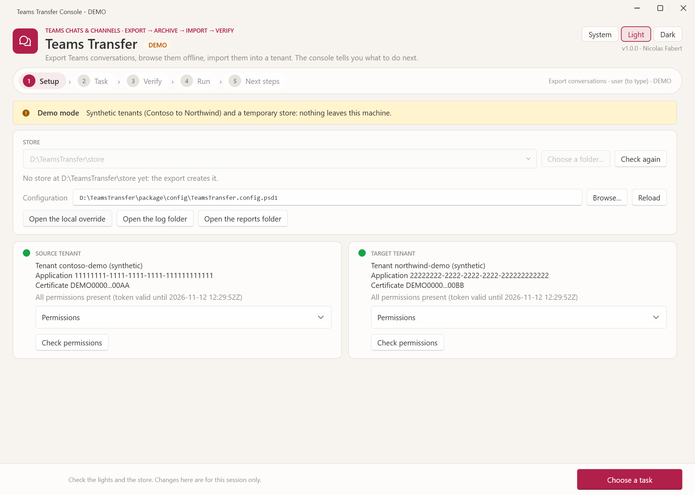
</picture>
</details>

### A &middot; Export and read offline &middot; 5 to 7

```powershell
# 5 · Estimate, then list what exists (reads only). The estimate gives volume, duration and waves for the whole tenant.
.\Invoke-TeamsTransfer.ps1 -Mode Assess -SampleUsers 30
.\Invoke-TeamsTransfer.ps1 -Mode Inventory -StoreRoot D:\ttstore

# 6 · Export the last 24 months, channels and files included. Run it again later: only what changed is read.
.\Invoke-TeamsTransfer.ps1 -Mode Export -StoreRoot D:\ttstore -Window 24m -IncludeChannels -IncludeFiles

# 7 · Read offline: a Teams-like HTML archive that opens by double-click, with no network.
.\Invoke-TeamsTransfer.ps1 -Mode Archive -StoreRoot D:\ttstore -Users camille.martin@contoso.com -OutputPath D:\archives\camille
```

<details>
<summary><b>What you see</b> &middot; Verify, Run, and the offline archive of one export</summary>
<br>
<table>
  <tr>
    <td width="50%" valign="top"><a href="package/docs/images/console-verify-export-light.png">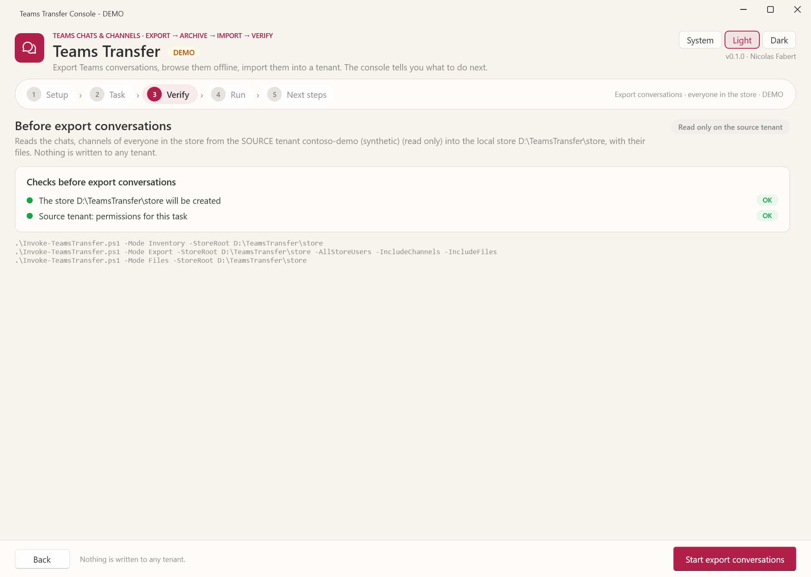</a><br><sub><b>Verify</b> &middot; the checks and the exact commands, read before Start</sub></td>
    <td width="50%" valign="top"><a href="package/docs/images/console-run-export-light.png">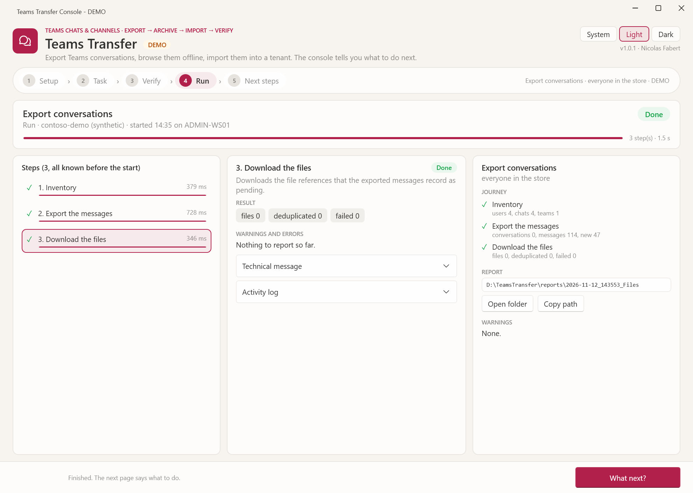</a><br><sub><b>Run</b> &middot; the steps, the counters and the report folder</sub></td>
  </tr>
  <tr>
    <td width="50%" valign="top"><a href="package/docs/images/preview-chat-light.png">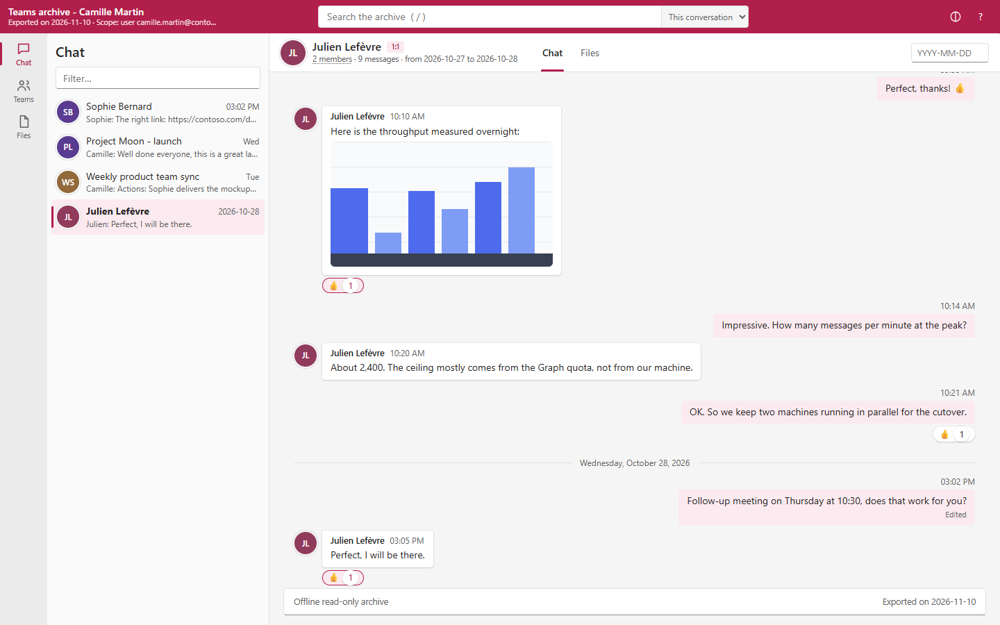</a><br><sub><b>Archive</b> &middot; a chat, as in Teams, with no network</sub></td>
    <td width="50%" valign="top"><a href="package/docs/images/preview-channel-light.png">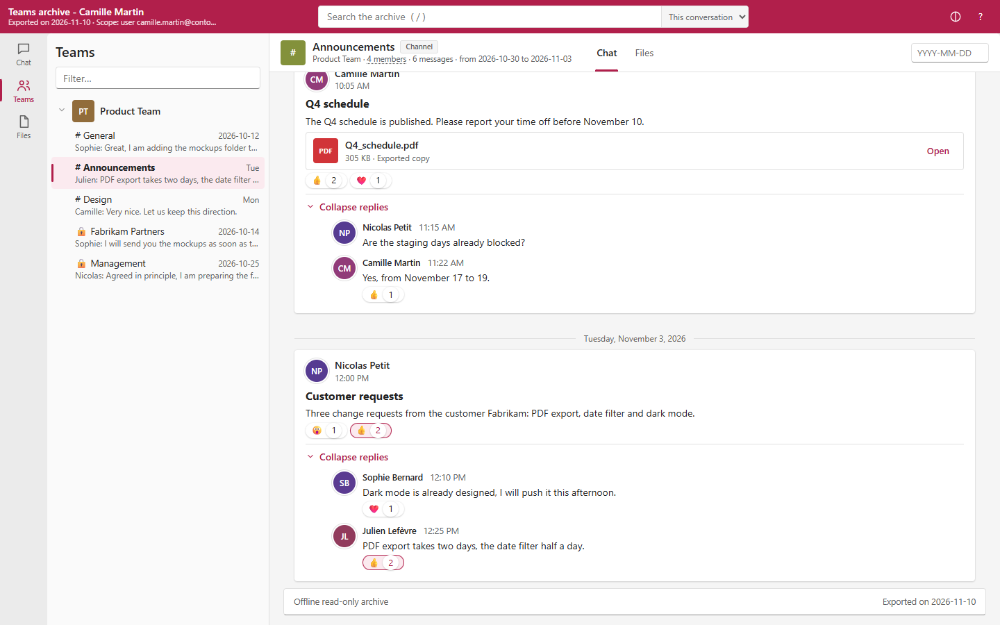</a><br><sub><b>Archive</b> &middot; a channel with its posts, files and replies</sub></td>
  </tr>
</table>
</details>

### B &middot; Import into a tenant &middot; 5 to 7

```powershell
# 5 · Plan a lot: a dry run that writes nothing to a tenant. Read plan.html: destinations, authors, ghosts, files, blockers, duration.
.\Invoke-TeamsTransfer.ps1 -Mode Plan -StoreRoot D:\ttstore -Lot wave1 -DomainMap contoso.com=fabrikam.com -ServiceAccount svc-migration@fabrikam.com -GhostDomain fabrikam.com

# 6 · Ghost accounts, files, then messages. Each mode is a preview first; add -Apply to write. An import cannot be undone.
.\Invoke-TeamsTransfer.ps1 -Mode Ghosts -StoreRoot D:\ttstore -Lot wave1 -GhostDomain fabrikam.com -CreateTrackingGroup
.\Invoke-TeamsTransfer.ps1 -Mode CopyFiles -StoreRoot D:\ttstore -Lot wave1
.\Invoke-TeamsTransfer.ps1 -Mode Import -StoreRoot D:\ttstore -Lot wave1
.\Invoke-TeamsTransfer.ps1 -Mode Import -StoreRoot D:\ttstore -Lot wave1 -Apply

# 7 · Verify: the target is read back chat by chat. Read verify.html: OK, Mismatch, Missing, NotCompleted or Unverified.
.\Invoke-TeamsTransfer.ps1 -Mode Verify -StoreRoot D:\ttstore -Lot wave1
```

<details>
<summary><b>What you see</b> &middot; the preview, the run and the verification of one import</summary>
<br>
<table>
  <tr>
    <td width="50%" valign="top"><a href="package/docs/images/console-verify-import-preview-light.png">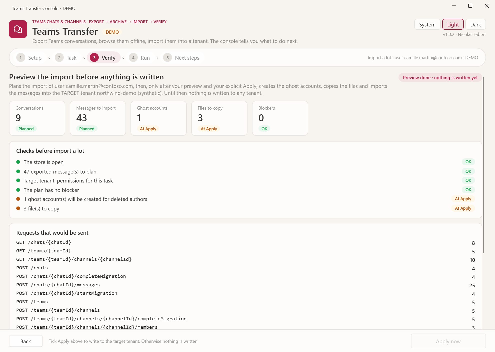</a><br><sub><b>Preview</b> &middot; counters, checks and the exact requests, before Apply</sub></td>
    <td width="50%" valign="top"><a href="package/docs/images/console-run-import-light.png">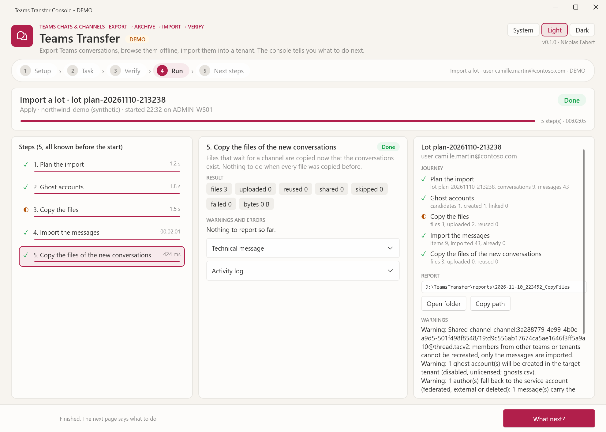</a><br><sub><b>Run</b> &middot; plan, ghosts, files, messages, in one guided run</sub></td>
  </tr>
  <tr>
    <td width="50%" valign="top"><a href="package/docs/images/console-run-verify-light.png">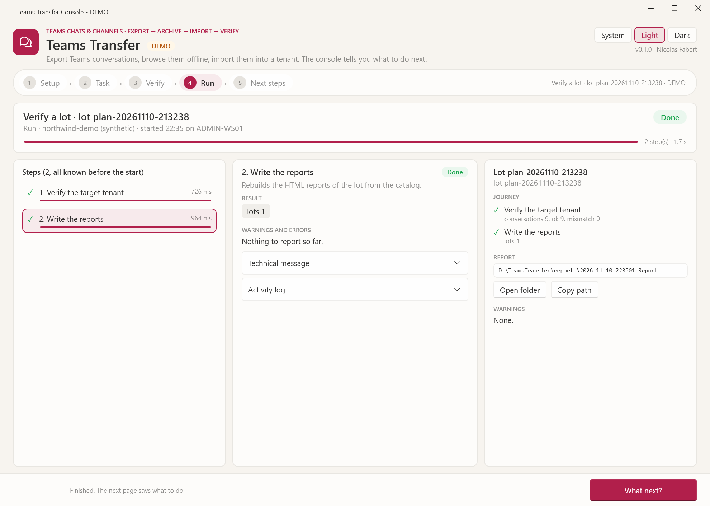</a><br><sub><b>Verify</b> &middot; each conversation read back and compared</sub></td>
    <td width="50%" valign="top"><a href="package/docs/images/console-next-verify-light.png">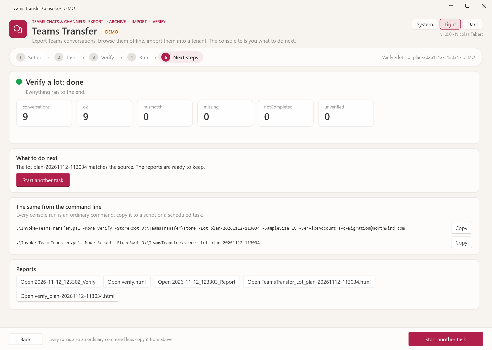</a><br><sub><b>Next steps</b> &middot; the result, the command line, the reports</sub></td>
  </tr>
</table>
</details>

## How it works

1. **Export.** Reads the chats and the channels of the source tenant with application permissions and a certificate, obeys the throttling of the service and writes a local store (a SQLite catalog, compressed message segments, a content store for images and files). A second run reads only what changed.
2. **Archive.** Writes an offline, Teams-like HTML archive that anybody can open without Teams.
3. **Plan.** You group conversations into lots (by user, team or CSV). The plan is a dry run: destinations, author mapping, files, blockers, estimated duration.
4. **Ghosts, copy files, import.** Ghost accounts first, then the files, then each conversation is opened with `startMigration`, filled with its messages at their original dates and authors, and closed with `completeMigration`.
5. **Verify.** The target is read back and compared with the journal and the source.

The first wave of a lot is the last 24 months; older history follows as extension waves. The service allows about 5 messages per second per conversation, so plan the volume you re-inject: everything else stays in the archive. The [package README](package/README.md) has the details and the [reference guide](package/docs/TeamsTransfer-Guide.md) explains every mode.

## Console

The console is a guided path in five pages: **Setup**, **Task**, **Verify**, **Run**, **Next steps**. Every run is shown as the normal command you could type, so what the console does can be repeated or scheduled from the command line. The light and dark themes follow Windows, and `-Demo` runs the whole path on synthetic tenants.

<picture>
  <source media="(prefers-color-scheme: dark)" srcset="package/docs/images/console-task-dark.png">
  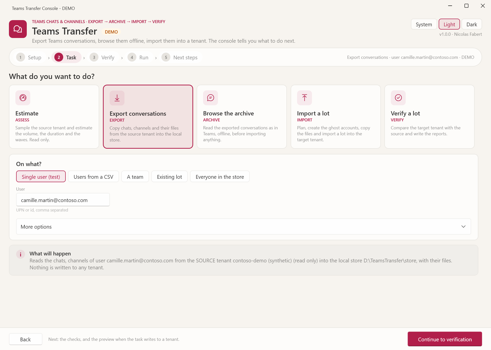
</picture>

## Reports

Every run writes a log and a report folder. Treat all of it as personal data: it repeats names, addresses and message text.

| Output | What it is |
|---|---|
| Archive | A Teams-like HTML archive (a folder, or one file with `-SingleFile`) that opens by double-click, with no network |
| `plan.html`, `plan.json` | The dry run of an import: conversations, authors, ghosts, files, blockers, estimated duration |
| `verify.html`, `verify.csv` | The comparison after the import: OK, Mismatch, Missing, NotCompleted or Unverified per conversation |
| CSV files | `conversations.csv`, `identities.csv`, `ghosts.csv`, `issues.csv`, `rejected.csv`: the detail behind each report |
| Logs | `TeamsTransfer_yyyyMMdd.log`: numbered steps, no token, no secret; the final card names the log and the report |

The [reference guide](package/docs/TeamsTransfer-Guide.md) lists every file of every mode.

## Requirements

- Windows x64 with PowerShell 7.4 or later (`pwsh.exe`). Windows PowerShell 5.1 is refused.
- One app registration per side (a read-only source app, a target app that writes) with certificate sign-in; the permissions are listed in the [user guide](package/docs/TeamsTransfer-UserGuide.md) and in the [reference guide](package/docs/TeamsTransfer-Guide.md).
- A certificate whose public part is uploaded to each app registration. No secret is ever stored.
- A local disk for the store. A network share is refused.
- For the console: the Microsoft Edge WebView2 runtime (optional: only the Explorer preview needs it).

## Quick start

1. Download `TeamsTransfer-1.0.0-win-x64.zip` from the [latest release](https://github.com/Nico77600/TeamsTransfer/releases/latest) (under Assets, not Source code) and extract it into a writable, access-restricted local folder, for example `D:\Tools`.
2. Check the publisher (right-click `Invoke-TeamsTransfer.ps1`, Properties, Digital Signatures), then unblock the folder once:

   ```powershell
   Get-ChildItem . -Recurse -File -Force |
       Unblock-File
   ```

3. Fill in `config\TeamsTransfer.config.local.psd1` (tenant ids, application ids, certificate thumbprints), or let the console show what is missing.
4. Start with something that touches nothing:

   ```powershell
   .\Start-TeamsTransferConsole.cmd -Demo
   .\Invoke-TeamsTransfer.ps1 -Mode Assess -SampleUsers 30
   ```

The [package README](package/README.md) has the full table of modes, from `Assess` to `Verify`.

## Documentation

- [Package README](package/README.md): requirements, quick start, content, data handling
- [User guide](package/docs/TeamsTransfer-UserGuide.md): for the operator, one picture per step
- [Reference guide](package/docs/TeamsTransfer-Guide.md): for the engineer
- [Change log](package/CHANGELOG.md)
- [Security policy](SECURITY.md)
- [Third-party notices](package/THIRD-PARTY-NOTICES.md)
- [Development and release rules](AGENTS.md)

## Tests

The tests are offline (a fake Graph and a synthetic tenant: no network, no tenant) and need Pester 5 and PowerShell 7.4 or later. From the repository root:

```powershell
Invoke-Pester .\tests
```

Building the documentation, the package and the signed release is described in [annex D of the reference guide](package/docs/TeamsTransfer-Guide.md#annex-d--release-procedure).

## License

[MIT](package/LICENSE), copyright Nicolas Fabert. Third-party components: [THIRD-PARTY-NOTICES.md](package/THIRD-PARTY-NOTICES.md).

## Disclaimer

This Script is a Personal project.
It's provided "AS-IS". It's not an official Microsoft product so no support can be expected from Microsoft.

As any scripts you must read carefully the documentation and test it first in a Test environment before any run in Production.

Import creates conversations in the target tenant and an imported conversation cannot be rolled back: run the preview, review the plan and test in a lab before using it on real data.
