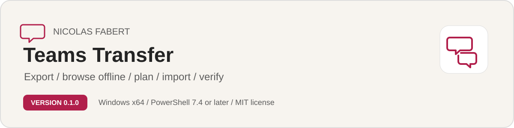

# Teams Transfer

**Author: Nicolas Fabert (Nico77600)** | Version 1.0.0 | [Latest release](https://github.com/Nico77600/TeamsTransfer/releases/latest) | MIT license

<picture>
  <source media="(prefers-color-scheme: dark)" srcset="docs/images/readme-banner-dark.svg">
  
</picture>

Exports Microsoft Teams chats and channels (messages, reactions, images, files) from a tenant into a verified local store, lets you read them offline in a Teams-like HTML archive, and imports them into a tenant with the Microsoft Graph Teams migration API, in named lots and in waves, with a ghost account for every deleted author and a verification at the end. A guided WPF console and a scriptable command line drive the same engine.

This folder contains everything needed to run the tool: `Invoke-TeamsTransfer.ps1`, the console launcher, the PowerShell modules, the C# engine sources (compiled in memory at each start), the pinned libraries, the configuration, the archive template and the two guides. Tests and build tools stay outside it, in the repository.

> [!IMPORTANT]
> Windows marks files downloaded from the Internet. Once the release ZIP is extracted, check the publisher first (right-click `Invoke-TeamsTransfer.ps1`, Properties, Digital Signatures: `Nicolas Fabert`), then unblock the folder once, from PowerShell opened in it:
>
> ```powershell
> Get-ChildItem . -Recurse -File -Force |
>     Unblock-File
> ```
>
> A release package is signed by its owner and verified before anything runs. A source checkout or a development package (no owner signature) starts only with `-DevelopmentMode`, and the tool says so at every start. Do not disable your execution policy or the check to clear an error.
>
> Imported messages cannot be rolled back. Run every write mode as a preview first, read the plan, and test in a lab tenant before you touch production. See the [Disclaimer](#disclaimer).

## Requirements

- PowerShell 7.4 or later (`pwsh.exe`) on Windows x64. Windows PowerShell 5.1 is refused.
- For the console: the Microsoft Edge WebView2 runtime (installed with Windows 11 and Microsoft 365 Apps, or from the Microsoft WebView2 download page). Without it the console still runs, only the Explorer preview is missing; the archive can always be opened in any current browser.
- One app registration per side with certificate sign-in and the application permissions listed in the [user guide, chapter 2](docs/TeamsTransfer-UserGuide.md#2-before-you-start) (plain version) and in the [reference guide, chapter 5](docs/TeamsTransfer-Guide.md#5-minimum-permissions-per-mode) (derived from the code):
  - a read-only **source** app: `Chat.Read.All`, `ChannelMessage.Read.All`, `ChatMember.Read.All`, `Team.ReadBasic.All`, `TeamMember.Read.All`, `Channel.ReadBasic.All`, `ChannelMember.Read.All`, `User.Read.All`, `Files.Read.All`, `Sites.Read.All`;
  - a **target** app that writes: `Teamwork.Migrate.All` and the other write permissions of the reference guide.
- A certificate (private key in `Cert:\CurrentUser\My` or `Cert:\LocalMachine\My`) whose public part is uploaded to each app registration. No secret is ever stored.
- A local disk for the store, outside the package folder. A network share is refused.
- A current desktop browser to read the archive and the HTML reports.

## Quick start

Extract the whole ZIP into a writable, access-restricted local folder, for example `D:\Tools\TeamsTransfer`, and open PowerShell 7 in it. Fill in `config\TeamsTransfer.config.local.psd1` (tenant ids, application ids, certificate thumbprints; see the user guide), or let the console show you what is missing.

- **Use the guided console** (start here)
  - Run: `Start-TeamsTransferConsole.cmd` (or `pwsh -STA -File .\Invoke-TeamsTransfer.ps1 -Gui`)
  - You get: five pages: Setup, Task, Verify, Run, Next steps; every run is shown as a normal command you can copy
- Try the console without any tenant
  - Run: `Start-TeamsTransferConsole.cmd -Demo`
  - You get: synthetic tenants, a temporary store, a DEMO badge; nothing leaves the machine (the demo engine ships in `demo\`, compiled in Demo mode only)
- See the state of the store
  - Run: `.\Invoke-TeamsTransfer.ps1` (mode `Status`, the default)
  - You get: counts, inventory pass, pending files, every lot with its state; writes nothing
- **Estimate** the project
  - Run: `.\Invoke-TeamsTransfer.ps1 -Mode Assess -SampleUsers 30`
  - You get: volume, duration and waves extrapolated to the whole tenant; a report folder, no store
- List what exists
  - Run: `.\Invoke-TeamsTransfer.ps1 -Mode Inventory -StoreRoot D:\ttstore`
  - You get: users (deleted and guests included), chats, teams, channels and members in the store; resumable
- **Export**
  - Run: `.\Invoke-TeamsTransfer.ps1 -Mode Export -StoreRoot D:\ttstore -Window 24m -IncludeChannels -IncludeFiles`
  - You get: messages, reactions, images and files in the store; run it again to take only what changed
- Download files later
  - Run: `.\Invoke-TeamsTransfer.ps1 -Mode Files -StoreRoot D:\ttstore -MaxFileSizeMB 200`
  - You get: the file references recorded as Pending, downloaded
- **Browse offline**
  - Run: `.\Invoke-TeamsTransfer.ps1 -Mode Archive -StoreRoot D:\ttstore -Users camille.martin@contoso.com -OutputPath D:\archives\camille`
  - You get: a Teams-like HTML archive (folder or `-SingleFile`) that opens by double-click, no network
- **Plan** an import
  - Run: `.\Invoke-TeamsTransfer.ps1 -Mode Plan -StoreRoot D:\ttstore -Lot wave1 -DomainMap contoso.com=fabrikam.com -ServiceAccount svc-migration@fabrikam.com -GhostDomain fabrikam.com`
  - You get: `plan.html`, `plan.json` and CSV files: conversations, authors, ghosts, files, blockers, estimated duration; nothing is written to a tenant
- Create the ghost accounts
  - Run: `.\Invoke-TeamsTransfer.ps1 -Mode Ghosts -StoreRoot D:\ttstore -Lot wave1 -GhostDomain fabrikam.com -CreateTrackingGroup` (add `-Apply`)
  - You get: a preview list; with `-Apply`, one disabled unlicensed account per deleted author
- Copy the files
  - Run: `.\Invoke-TeamsTransfer.ps1 -Mode CopyFiles -StoreRoot D:\ttstore -Lot wave1` (add `-Apply`)
  - You get: a preview per destination; with `-Apply`, the files uploaded and shared
- **Import** a lot
  - Run: `.\Invoke-TeamsTransfer.ps1 -Mode Import -StoreRoot D:\ttstore -Lot wave1` (add `-Apply`)
  - You get: a preview with the exact requests per endpoint; with `-Apply`, the messages imported, never twice
- **Verify**
  - Run: `.\Invoke-TeamsTransfer.ps1 -Mode Verify -StoreRoot D:\ttstore -Lot wave1`
  - You get: `verify.html` and `verify.csv`: OK, Mismatch, Missing, NotCompleted or Unverified per conversation
- Rebuild the reports
  - Run: `.\Invoke-TeamsTransfer.ps1 -Mode Report -StoreRoot D:\ttstore`
  - You get: one HTML report per lot from the catalog; no network
- Share an export between computers
  - Run: `.\Invoke-TeamsTransfer.ps1 -Mode Export -StoreRoot D:\ws1\store -Lot ws1 -LotFile .\lots\ws1.csv`, then on the coordinator `-Mode Merge -StoreRoot D:\coordinator\store -FromStore \\ws1\share\store`, then `-Mode Plan -Lot ws1 -LotFile .\lots\ws1.csv`
  - You get: each workstation exports a disjoint lot into its own store; the coordinator folds each store in (read only, idempotent) and plans the same lot
- Abandon a lot that has not started importing
  - Run: `.\Invoke-TeamsTransfer.ps1 -Mode Status -Lot wave1 -CancelLot -Reason 'wrong scope'`
  - You get: the lot is Cancelled, its conversations are free for another lot; the local store only

Every run writes a log (`TeamsTransfer_yyyyMMdd.log`), numbered steps, and a final card that names the log and the report. Exit codes: 0 complete, 1 failed, 2 not complete but resumable (run the same command again), 3 uncertain items (see `-Mode Status`).

## How it works

1. **Export.** The tool reads the chats and the channels of the source tenant with application permissions and a certificate, obeys the throttling of the service, and writes them to a local store: a SQLite catalog, 256 message partitions in compressed append-only segments, and a content store for images and files, de-duplicated by SHA256. A second run reads only what changed.
2. **Archive.** From the store, the tool writes an offline, Teams-like HTML archive that anybody can open without Teams. What is not re-imported stays readable there.
3. **Plan.** You group conversations into **lots** (by user, team or CSV). The plan is a dry run: where every conversation goes, how every author is mapped (CSV, domain rule, same user, ghost, service account), which files must be copied, what blocks the import and how long it will take.
4. **Ghosts.** An author who was deleted at the source cannot be named in the target. The tool creates one disabled, unlicensed ghost account per such author ("First Last (former)") so that the original author is kept.
5. **Copy files, then Import.** The files are copied first. Then each conversation is opened with `startMigration`, filled with its messages at their original dates and authors, and closed with `completeMigration`. A journal makes the run resumable and idempotent: a message is never sent twice.
6. **Verify.** The target is read back chat by chat and compared with the journal and the source.

**Lots and waves.** The first wave of a lot is the last 24 months. Older history comes later as extension waves (months 25 to 36, 37 to 48, 49 to 60, further if configured): a finished conversation is reopened with an earlier start date and filled with older messages. The service allows about 5 messages per second per conversation and roughly 60 to 90 messages per second per application, so importing years of history takes weeks or months. Plan the volume you re-inject; everything else stays in the archive.

## Content

- `Start-TeamsTransferConsole.cmd`: Launcher of the guided console (STA PowerShell, WPF).
- `Invoke-TeamsTransfer.ps1`: Entry script: every mode, the package check and the console.
- `TeamsTransfer.psd1`, `TeamsTransfer.psm1`: Module manifest and loader.
- `TeamsTransfer.Console.ps1`, `.Export.ps1`, `.Archive.ps1`, `.Plan.ps1`, `.Import.ps1`, `.Verify.ps1`: Console output, log and the PowerShell surface of each stage.
- `TeamsTransfer.Gui*.ps1`, `ui\`, `demo\`: The guided console (WPF-UI Fluent XAML pages) and its Demo mode (the demo engine, never loaded by the command-line modes).
- `src\`: The C# engine sources (Graph client, limiter, store, catalog, export, plan, ghosts, file copy, import, verify, archive), compiled in memory at each start, and the integrity verifier.
- `templates\`: The Teams-like archive page and its script.
- `schemas\`: The archive data contract (`preview-v1`).
- `config\`: `TeamsTransfer.config.psd1` (data only, never a secret), `Permissions.psd1` (the permissions each mode needs, per side) and your private `TeamsTransfer.config.local.psd1`.
- `lib\`, `dependency-lock.json`: Pinned SQLite, WebView2 and WPF-UI libraries with their licenses and hashes.
- `docs\`: User guide and reference guide, Markdown and self-contained HTML, with images.
- `PackageIntegrity.psd1`: Manifest of every protected file, written by the package builder and signed by the owner for a release.
- `README.md`, `CHANGELOG.md`, `SECURITY.md`, `LICENSE`, `THIRD-PARTY-NOTICES.md`: Documents and notices.

`out\` (logs, reports, the default store) is created at run time **next to** the package folder (`<parent>\out`), never inside it, and is never part of the package. Keep the store outside this folder.

## Documentation

- [User guide](docs/TeamsTransfer-UserGuide.md) - for the operator, step by step, one picture per step; also `docs\TeamsTransfer-UserGuide.html`, a single file to open locally
- [Reference guide](docs/TeamsTransfer-Guide.md) - architecture, every mode and parameter, configuration, permissions, Graph endpoints, limits, troubleshooting; also `docs\TeamsTransfer-Guide.html`
- [Change log](CHANGELOG.md)
- [Security policy](SECURITY.md)

Project page and releases: https://github.com/Nico77600/TeamsTransfer (latest release: https://github.com/Nico77600/TeamsTransfer/releases/latest)

License: [MIT](LICENSE). Third-party components: [THIRD-PARTY-NOTICES.md](THIRD-PARTY-NOTICES.md).

## Data handling

The tool reads and writes people's conversations. Treat everything it produces as personal data.

- **The store** (`Store.Path`, or `out\store`) holds the messages, member lists, images and files of the exported conversations, and the catalog with the lots, the identity and target maps, the import journal and the ghosts. The archive and the reports repeat names, e-mail addresses and message text. Put them on an encrypted local disk with restricted access, keep them as long as the project needs and no longer, and delete them (and their backups) afterwards. The tool never deletes an exported store on its own.
- **No secret is stored.** The configuration is parsed as data and never executed; it holds tenant ids, application ids and certificate thumbprints only. The private key stays in the Windows certificate store. The logs, the console and the reports show no token, no password and no key. A ghost account gets a random password that is never stored.
- **Read-only modes.** `Assess`, `Inventory`, `Export`, `Files`, `Plan`, `Verify` and the console's Explorer only read the tenants (the plan and the verification read the target). They write locally: the store, the catalog, the plan folder, the logs and the report folders. `Archive`, `Status` and `Report` read the store only (`Status -CancelLot` changes the local store after a confirmation).
- **What is written to the target tenant**, and only with `-Apply` (the console asks for a tick and a confirmation): the ghost accounts and their tracking group (`Ghosts`), the files in OneDrive and in the channel libraries and their sharing (`CopyFiles`), and the teams, channels, chats, members and messages (`Import`). Without `-Apply` these modes only preview. `-WhatIf` always wins over `-Apply`. An imported conversation cannot be rolled back.
- **The offline archive** is self-contained: a strict content security policy forbids every network access, message HTML is cleaned with an allow-list, and links that leave the archive ask before they open. It still contains the full conversations: protect it like the store.
- The package contains PowerShell scripts, C# sources compiled in memory, and third-party binaries (SQLite, WebView2, WPF-UI). A manifest checks every protected file before anything runs; `config\` and `out\` are not protected.

## Disclaimer

This Script is a Personal project.
It's provided "AS-IS". It's not an official Microsoft product so no support can be expected from Microsoft.

As any scripts you must read carefully the documentation and test it first in a Test environment before any run in Production.

Import creates conversations in the target tenant and an imported conversation cannot be rolled back: run the preview, review the plan and test in a lab before using it on real data.
