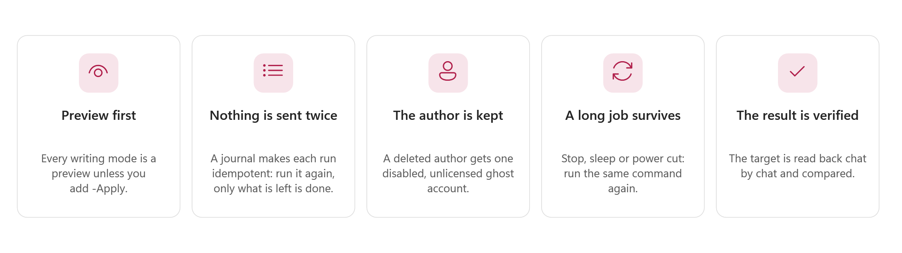
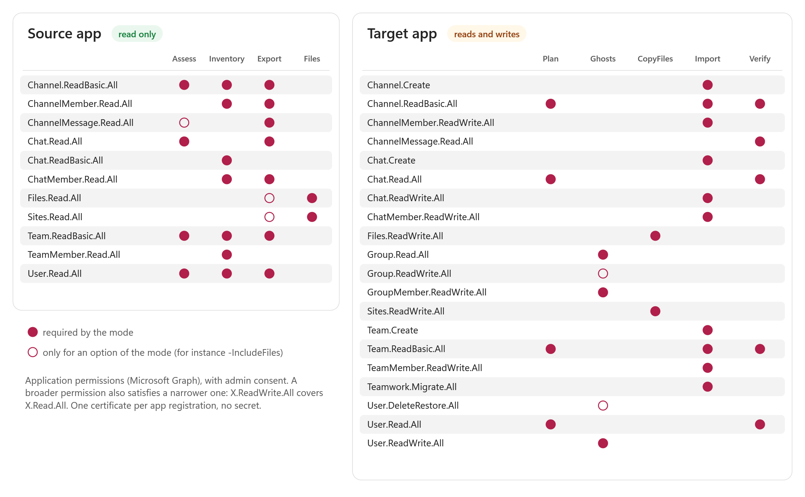
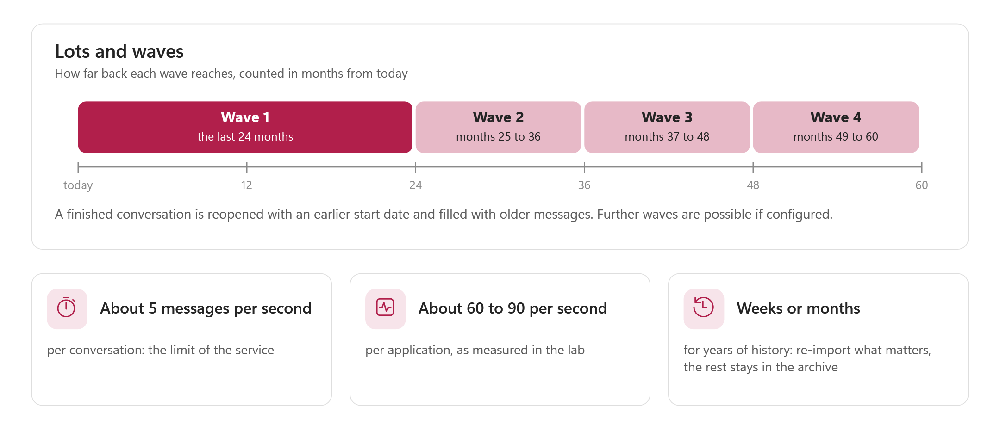

# Teams Transfer — Reference guide

> For the engineer who installs, runs, schedules and troubleshoots the tool. The plain, step-by-step version is the [user guide](TeamsTransfer-UserGuide.md) (file `TeamsTransfer-UserGuide.html`, same `docs` folder). Everything here is derived from the code of version 1.0.1 and from the measurements of the lab (`docs\design\Phase0-Results.md`); a statement that comes from the lab and not from the code is marked *(lab)*.

> [!IMPORTANT]
> Files downloaded from the Internet may be blocked by Windows and fail to run. Check the publisher first (`Invoke-TeamsTransfer.ps1`, Properties, Digital Signatures: `Nicolas Fabert`), then unblock the extracted folder:
>
> ```powershell
> Get-ChildItem "D:\Tools\TeamsTransfer" -Recurse -File -Force | Unblock-File
> ```

# Part I · Understand

<!-- icon: target -->
## 1. Scope and principles



Teams Transfer exports Microsoft Teams chats and channels (messages, replies, reactions, mentions, inline images, attached files, members) from a tenant into a local store, shows them offline in a Teams-like HTML archive, and imports them into a tenant with the Microsoft Graph Teams migration API.

**Three scenarios** (the `-Scenario` of `Plan`):

| | A · `TenantToTenant` (default) | B · `SameTenantRestore` | C · `DepartedArchive` |
|---|---|---|---|
| Applications | a source app (read) and a target app (write) | one tenant, a read app and a write app | same |
| Identities | source person to target person by CSV, domain rule or same UPN; unknown people block the plan | the same person; a recreated account is found by UPN or mail | the departed author is replaced by a ghost or the service account |
| Target conversation | chat recreated with the mapped members; team and channel created or mapped | the existing chat or channel (appended to) when it still exists, otherwise as A | **archive teams**: one private channel per departed user, teams `<prefix> NN` with at most `-ChannelsPerArchiveTeam` channels each |
| Duplicates | none: the target is empty | messages already there are recognised by fingerprint (date, author, body hash) and skipped | the import journal |

**Principles** the code follows everywhere:

- **The source is read, never written.** The read modes use the source application; the modes that write use the target application, and only with `-Apply`.
- **Preview first.** `Ghosts`, `CopyFiles` and `Import` preview unless `-Apply` is given. `-WhatIf` always wins over `-Apply`. The plan is a dry run that blocks on anything unresolved.
- **Resumable and idempotent.** Every stage records its progress (watermarks, `@odata.nextLink`, the import journal). Running the same command again continues; a message is never sent twice.
- **Throttling is obeyed, not worked around.** `Retry-After` is honoured exactly and the rate is lowered on `429` and `503`.
- **No secret anywhere.** Certificate sign-in; the configuration holds ids and thumbprints only; logs and reports hold no token, header or body.
- **Offline tests.** The whole engine is tested against a fake Graph and a synthetic tenant; the console's Demo mode uses the same fakes.
- **English only**: console, log, reports, archive page, documentation. Numbers and dates are always shown the `en-US` way.

<!-- icon: layers -->
## 2. Architecture


```flow
terminal | Invoke-TeamsTransfer.ps1 | modes, console
arrow | calls |
gear | TeamsTransfer module | Tmt functions
arrow | compiles |
layers | C# engine | src\Engine.*.cs, in memory
arrow | reads / writes |
database | Store | catalog, partitions, content
```

| Layer | What it is |
|---|---|
| **Entry script** `Invoke-TeamsTransfer.ps1` | Package check, parameter rules (which parameter belongs to which mode), configuration, log, banner, one block per mode, final card, exit code. `-Gui` hands over to the console. |
| **Module** `TeamsTransfer.psm1` and its parts | `TeamsTransfer.Console.ps1` (colours, icons, banner, steps, log, end card), `.Export.ps1` (configuration, Graph client, inventory, assess, export, files, archive helpers), `.Archive.ps1`, `.Plan.ps1`, `.Import.ps1` (ghosts, file copy, import), `.Verify.ps1` (verify, lot reports). Each function has its comment-based help. |
| **Engine** `src\Engine.*.cs` | C# compiled in memory at each start (no compiled copy is ever loaded from disk, `bin\` is never trusted). The module refuses an engine already loaded in the session if it was compiled from other sources. |
| **Libraries** `lib\` | `Microsoft.Data.Sqlite` and SQLitePCLRaw with the native `e_sqlite3` for `win-x64` and `win-arm64`; for the console, WPF-UI and the WebView2 SDK. Pinned in `dependency-lock.json`. |
| **Console** `TeamsTransfer.Gui*.ps1`, `ui\*.xaml` | WPF-UI Fluent window over the same module functions. Jobs run in background runspaces. |
| **Archive template** `templates\Archive.template.*` | The viewer page (HTML and JavaScript, no library, no network). |

### The engine, part by part

| File | Responsibility |
|---|---|
| `Engine.Auth.cs` | OAuth2 client credentials with a **certificate** (JWT assertion signed with the RSA key from `CurrentUser\My` or `LocalMachine\My`). A client secret provider exists in the code for tests only. |
| `Engine.Graph.cs` | HTTP transport (one shared `HttpClient`, streamed responses) and `GraphClient`: retry with `Retry-After`, jittered backoff, `@odata.nextLink` paging with page-level resume, streamed downloads, JSON `$batch` (20 per call). |
| `Engine.Throttle.cs` | The adaptive rate limiter (chapter 6). |
| `Engine.Inventory.cs` | Enumerates users (deleted and guests included), chats (deduplicated across users), teams, channels and members into the store. Also hosts the shared work helpers (stop control, progress, bounded parallelism). |
| `Engine.Export.cs` | Message export with strategy U (per user) or C (per chat), channel export, hosted contents (images), file references and the `Files` stage. |
| `Engine.Store.cs`, `Engine.StoreContracts.cs` | The partitioned message store and the content store. |
| `Engine.Catalog.cs`, `Engine.CatalogImport.cs` | The SQLite catalog: users, conversations, links, checkpoints, files, lots, work units, import journal, ghosts, identity and target maps, file-copy map. |
| `Engine.Mapping.cs`, `Engine.Plan.cs` | Identity and target mapping, and the dry-run plan with its reports. |
| `Engine.Ghosts.cs` | Ghost accounts of deleted authors. |
| `Engine.FileCopy.cs` | Copy of the exported files into the target tenant. |
| `Engine.Import.cs`, `Engine.ImportContracts.cs` | The importer: migration sessions, messages, journal, completion. |
| `Engine.Verify.cs` | Verification and the lot report. |
| `Engine.Preview.cs` | The offline archive generator. |
| `Engine.Contracts.cs` | Shared contracts: `EndpointClass`, `GraphException`, options. |

### Stages and where they write

| Stage | Reads | Writes locally | Writes to a tenant |
|---|---|---|---|
| Assess | source tenant | report folder | nothing |
| Inventory | source tenant | store (catalog) | nothing |
| Export, Files | source tenant | store (messages, content, files) | nothing |
| Archive | store | archive folder or file | nothing |
| Plan | store, target tenant | identity and target maps, journal (seeded), ghost table, lot state, plan folder | **nothing** |
| Ghosts | store, target tenant | ghost table | ghost users and tracking group, only with `-Apply` |
| CopyFiles | store, target tenant | file-copy map | OneDrive and channel library files and their sharing, only with `-Apply` |
| Import | store, target tenant | journal, sessions, maps, lot state | teams, channels, chats, members, messages, only with `-Apply` |
| Verify | store, target tenant | verification files, lot state | nothing |
| Report | store | reports | nothing |
| Merge | the other store (read only) | this store | nothing |

# Part II · Set up

<!-- icon: download -->
## 3. Installation and package integrity

### Requirements

- Windows x64 (the native SQLite and WebView2 loaders for `win-arm64` are in `lib\`, but only x64 is tested), PowerShell 7.4 or later. `#Requires -Version 7.4`; Windows PowerShell 5.1 is refused.
- For the console: the Microsoft Edge WebView2 **runtime** (not redistributed). Without it the Explorer shows a message and everything else works.
- A **local disk** for the store, outside the package folder.
- Per side an app registration with a certificate (chapter 5; the plain steps are in the user guide, chapter 2).

`Start-TeamsTransferConsole.cmd` uses `powershell\pwsh.exe` next to it when that folder exists and `pwsh.exe` from the PATH otherwise; it checks the package files, passes `-DevelopmentMode` itself when there is no `PackageIntegrity.psd1`, and forwards extra arguments (for example `-Demo`).

### Package integrity

`Invoke-TeamsTransfer.ps1` verifies the package **before any of its code runs**: `src\Test-PackageIntegrity.ps1` checks `PackageIntegrity.psd1`, the SHA256 of every file of the package. A missing, changed, unlisted, duplicated or reparse-point file fails closed. There are three states, always announced:

| Status | Meaning | Starts without `-DevelopmentMode`? |
|---|---|---|
| `Valid` | The verifier, the manifest and every PowerShell file carry the trusted, timestamped owner signature (thumbprint `0F28E442889F17B5F4D251E8F96E7CC6E2C9C6D6`) and every hash matches. | Yes: the only state of a release |
| `UnsignedDevelopmentPackage` | A manifest exists, the owner signature does not; hashes are still enforced. | No |
| `UnverifiedDevelopmentTree` | No manifest: a source checkout. Nothing is verified. | No |

There is no silent bypass and no environment variable that disables the check. `-DevelopmentMode` is the only way to start a tree without a signed manifest, and the state is printed as a yellow warning and written to the log. `-Distribution` of the verifier makes the owner signature mandatory.

**Not protected by design:** `config\TeamsTransfer.config.psd1`, `config\TeamsTransfer.config.local.psd1` (data, never executed) and the generated folders `bin\`, `data\`, `logs\`, `out\` at the package root. Keep the store and the reports outside the package folder anyway: the store refuses to open inside it.

**Building and signing** (the owner signs; the script never signs): see the release procedure in annex D. In short: sign the PowerShell files, `tools\Build-Package.ps1 -Stage Prepare`, sign the manifest, `tools\Build-Package.ps1 -Stage Package -RequireSignature`. `tools\Build-PackageManifest.ps1` alone writes `package\PackageIntegrity.psd1` (every file, documentation and images included) and checks it in development mode.

Write the manifest again after **any** change in `package\`, documentation included. `tools\Get-TeamsTransferDependencies.ps1` installs and verifies the pinned GUI libraries (`-Verify` checks offline; `-UpdateLock` is for an intended dependency change).

### Folder layout

```text
TeamsTransfer\
  Start-TeamsTransferConsole.cmd  Invoke-TeamsTransfer.ps1  TeamsTransfer.psd1 / .psm1 / .*.ps1
  src\        Engine.*.cs, Test-PackageIntegrity.ps1
  ui\         MainWindow.xaml, Step.*.xaml, Page.Explorer.xaml
  templates\  Archive.template.html, Archive.template.js
  schemas\    preview-v1.schema.json
  config\     TeamsTransfer.config.psd1, TeamsTransfer.config.local.psd1 (yours)
  lib\        sqlite\, gui\, licenses\
  docs\       guides (.md and .html), images\
  PackageIntegrity.psd1  dependency-lock.json  README.md  CHANGELOG.md  SECURITY.md  LICENSE  THIRD-PARTY-NOTICES.md
```

<!-- icon: settings -->
## 4. Configuration

The configuration is **data**, parsed with `Import-PowerShellDataFile` and never executed. Layers, the last one wins, section by section:

1. built-in defaults;
2. `config\TeamsTransfer.config.psd1` (or the file given with `-ConfigPath`);
3. `config\TeamsTransfer.config.local.psd1` next to it, or the file named by the environment variable `TEAMSTRANSFER_LOCAL_CONFIG` (private values of the machine: tenant ids, application ids, thumbprints);
4. the command line, for one run. It never modifies a file.

| Key | Default | Meaning |
|---|---|---|
| `Source.Cloud`, `Target.Cloud` | `Global` | `Global`, `USGov`, `USGovDoD` or `China`: the Graph and login hosts. Credentials are never sent to a host other than the Graph endpoint. |
| `Source.TenantId`, `Target.TenantId` | empty | Tenant id (GUID) or `contoso.onmicrosoft.com`. |
| `Source.ClientId`, `Target.ClientId` | empty | Application (client) id of the read app / the write app. |
| `Source.CertificateThumbprint`, `Target.CertificateThumbprint` | empty | Thumbprint of a certificate with its private key in `Cert:\CurrentUser\My` or `Cert:\LocalMachine\My`. The key must be RSA. |
| `Target.ServiceAccountUserId` | empty | UPN or object id of the service account in the **target** tenant: owner of the teams the import creates, fallback author. Second in the resolution order (after `-ServiceAccount`) used by `Plan`, `Ghosts`, `CopyFiles`, `Import` and `Verify`. |
| `Graph.MaxAttempts` | `8` | Attempts per request (429, 5xx and network errors included). |
| `Graph.BaseBackoffSeconds` | `2` | Lower bound of the jittered backoff. |
| `Graph.MaxBackoffSeconds` | `120` | Upper bound of the backoff. |
| `Graph.RequestTimeoutSeconds` | `300` | Timeout of one request. |
| `Graph.ExportModel` | `B` | `model` parameter of the export APIs (`getAllMessages`). Required: without it the API falls back to an evaluation mode with a limited quota. |
| `Graph.InitialRatePerSecond` | `20` | Starting rate of the adaptive limiter, per endpoint class. |
| `Graph.MaxConcurrency` | `32` | Simultaneous requests for the whole process. |
| `Ghosts.DomainName` | empty | Domain of the ghost UPNs `tt-ghost-<hash>@<domain>`: a verified domain, or `contoso.onmicrosoft.com`, of the **target** tenant. `-GhostDomain` overrides it. |
| `Ghosts.DisplayNameFormat` | empty = `{0} (former)` | `{0}` is the source display name. |
| `Ghosts.TrackingGroupName` | `TeamsTransfer - Ghost accounts` | Group of which every ghost is a member. |
| `Ghosts.CreateTrackingGroup` | `$false` | Allow the tool to create the group when it does not exist (`-CreateTrackingGroup`). |
| `Ghosts.UsageLocation` | empty | Two-letter `usageLocation` set on the ghosts (`-UsageLocation`). |
| `Ghosts.ConfirmThreshold` | `5000` | Above this many ghosts to create, the stage is blocked unless `-ConfirmGhostCount`. |
| `Store.Path` | empty = `<Output.Root>\store` | Root of the local store, by default `<parent of the package>\out\store`. Refused inside the package folder and on a network share. |
| `Store.Partitions` | `256` | Message partitions, **fixed when the store is created**. |
| `Output.Root` | `.\out` | Parent of `logs\`, `reports\` and the default `store\`. A relative path is resolved against the **parent folder of the package** (`<parent>\out` next to `package\`), never the current folder and never inside the package. The banner shows it on its `OutFolder` line. |
| `Logging.RetentionDays` | `14` | `TeamsTransfer_*.log` files older than this are deleted when a run starts. |

**Environment variables:** `TEAMSTRANSFER_LOG_FOLDER` (default log folder), `TEAMSTRANSFER_LOCAL_CONFIG` (the local layer), `TMT_ICONS` (`Emoji`, `Symbols` or `Ascii`), `NO_COLOR` (no colour). The console stores its own settings (theme, store, recent stores) in `%LOCALAPPDATA%\TeamsTransfer\console-settings.json`.

> [!NOTE]
> **Set `Store.Path` and `Output.Root` explicitly for a real project** (an absolute path on a local disk). The defaults are safe (next to the package folder, never inside it) but are meant for a first try.

<!-- icon: key -->
## 5. Minimum permissions per mode



All permissions are Microsoft Graph **application** permissions with administrator consent. They come from **one table**, `package\config\Permissions.psd1` (per mode and side, required or optional, with the reason), which the console uses for its permission lights; the tables of this chapter are generated from it and `tests\Docs.Tests.ps1` compares them with the file. A broader permission covers a narrower one (`X.ReadWrite.All` covers `X.Read.All`, which covers `X.ReadBasic.All`); the console's check applies the same rule.

**Administrator roles** to create the apps and consent (lab script): *Application Administrator* or *Cloud Application Administrator* for the apps, *Privileged Role Administrator* or *Global Administrator* for the consent of application permissions.

### Source app (read only)

R = required by the mode, o = optional (only for the option named in the last column). Generated from `package\config\Permissions.psd1`.

| Permission | Assess | Inventory | Export | Files | Used for |
|---|---|---|---|---|---|
| `User.Read.All` | R | R | R |  | Counts and samples the users. |
| `Chat.Read.All` | R |  | R |  | Samples the chats and their messages (protected API). |
| `Team.ReadBasic.All` | R | R | R |  | Samples the teams (with -SampleTeams). |
| `Channel.ReadBasic.All` | R | R | R |  | Samples the channels (with -SampleTeams). |
| `ChannelMessage.Read.All` | o |  | R |  | Counts channel messages (with -SampleTeams). |
| `Chat.ReadBasic.All` |  | R |  |  | Lists the chats of every user (Chat.Read.All also satisfies it). |
| `ChatMember.Read.All` |  | R | R |  | Reads the members of the chats. |
| `TeamMember.Read.All` |  | R |  |  | Reads the members of the teams. |
| `ChannelMember.Read.All` |  | R | R |  | Reads the members of the private and shared channels. |
| `Files.Read.All` |  |  | o | R | Downloads the files (with -IncludeFiles). |
| `Sites.Read.All` |  |  | o | R | Reads the channel file libraries (with -IncludeFiles). |

`Archive`, `Status`, `Report`, `Merge` and `Plan -SkipTargetLookup` need **no** tenant permission. `Plan` reads the **target** tenant (below).

### Target app (read and write)

| Permission | Plan | Ghosts | CopyFiles | Import | Verify | Used for |
|---|---|---|---|---|---|---|
| `User.Read.All` | R |  |  |  | R | Looks the authors up in the target tenant (mapping). |
| `Team.ReadBasic.All` | R |  |  | R | R | Looks the teams up. |
| `Channel.ReadBasic.All` | R |  |  | R | R | Looks the channels up. |
| `Chat.Read.All` | R |  |  |  | R | Looks the existing chats up (scenario B). |
| `User.ReadWrite.All` |  | R |  |  |  | Creates and reads the ghost accounts. |
| `Group.Read.All` |  | R |  |  |  | Finds the ghost tracking group. |
| `GroupMember.ReadWrite.All` |  | R |  |  |  | Adds the ghost accounts to the tracking group. |
| `Group.ReadWrite.All` |  | o |  |  |  | Creates the tracking group (with -CreateTrackingGroup). |
| `User.DeleteRestore.All` |  | o |  |  |  | Purges removed ghosts (with -Remove -Purge). |
| `Files.ReadWrite.All` |  |  | R |  |  | Uploads the files into OneDrive and the channel libraries, and shares them. |
| `Sites.ReadWrite.All` |  |  | R |  |  | Writes into the SharePoint libraries of the channels. |
| `Teamwork.Migrate.All` |  |  |  | R |  | Starts, fills and completes the migration of chats and channels. |
| `Team.Create` |  |  |  | R |  | Creates the teams. |
| `Channel.Create` |  |  |  | R |  | Creates the channels. |
| `Chat.Create` |  |  |  | R |  | Creates the chats. |
| `Chat.ReadWrite.All` |  |  |  | R |  | Reads back the chats and their migration state. |
| `ChatMember.ReadWrite.All` |  |  |  | R |  | Adds the members of the chats. |
| `ChannelMember.ReadWrite.All` |  |  |  | R |  | Adds the members of the channels. |
| `TeamMember.ReadWrite.All` |  |  |  | R |  | Adds the members of the teams. |
| `ChannelMessage.Read.All` |  |  |  |  | R | Reads the imported channel messages. |

The lab helper `tools\Grant-LabConsent.ps1` carries its own list; the tables above are the authoritative ones. Note that the Reader also needs `Chat.ReadBasic.All`, the Writer needs `Chat.Read.All`, and `Group.ReadWrite.All` is optional (only for `-CreateTrackingGroup`).

**Only one application may start, import and complete a migration:** another application cannot import into (400) nor complete (401) a migration that it did not open *(lab, W4)*. The journal records the owner `appId` of each session; never change the target application in the middle of a lot.

**Teams protected APIs.** `Chat.Read.All` and `ChannelMessage.Read.All` as application permissions give access to every chat and channel message. Microsoft has documented a request form for this access and has changed the rule over time. In the lab the consent alone was enough *(lab)*. If an export answers `403` while the token shows the roles, ask the tenant administrator to check the current rule early: an approval can take days.

<!-- icon: gear -->
## 6. Graph endpoints, limits and throttling

### Endpoints used

All calls use `v1.0` of the cloud selected by `Cloud`.

| Stage | Endpoint |
|---|---|
| Inventory | `GET /users?$select=...`, `GET /directory/deletedItems/microsoft.graph.user`, `GET /users/{id}/chats?$expand=members&$top=50`, `GET /teams?$select=id` (fallback `GET /groups?$filter=resourceProvisioningOptions/Any(x:x eq 'Team')`), `GET /teams/{id}/channels`, `.../members`, `.../channels/{id}/members?$top=999` |
| Export, strategy U | `GET /users/{id}/chats/getAllMessages?$top=50&model=B&$filter=lastModifiedDateTime gt .. and lt ..` |
| Export, strategy C | `GET /chats/{id}/messages?$top=50` |
| Export, channels | `GET /teams/{id}/channels/getAllMessages` (replies included), or per channel `GET /teams/{t}/channels/{c}/messages` and `.../replies` |
| Hosted contents | `GET .../messages/{id}/hostedContents/{id}/$value` |
| Files (download) | `GET /shares/{u!...}/driveItem`, `.../content`, `GET /drives/{d}/items/{i}/content` |
| Plan | `$batch` (20 per call) of `GET /users/{id}`, `GET /users?$filter=userPrincipalName eq ...`, `GET /teams?$filter=displayName eq ...`, `GET /teams/{t}/channels`, `GET /chats/{id}` |
| Ghosts | `POST /users`, `GET /users/{id}`, `DELETE /users/{id}`, `GET`/`POST /groups`, `POST /groups/{id}/members/$ref`, `/directory/deletedItems` (purge) |
| CopyFiles | `GET /teams/{t}/channels/{c}/filesFolder`, `GET /users/{id}/drive`, `PUT .../root:/{folder}/{name}:/content?@microsoft.graph.conflictBehavior=rename`, `.../createUploadSession`, `POST /drives/{d}/items/{i}/invite` |
| Import | `POST /chats`, `POST /teams` (one member), `POST /teams/{t}/channels`, `POST .../members`, `POST /chats/{id}/startMigration`, `POST .../messages`, `POST .../messages/{id}/replies`, `POST .../completeMigration`, `GET` of the chat or channel for `migrationMode`, members `DELETE` and `POST` for the history of a group chat |
| Verify | `GET /chats/{id}/messages?$top=50`, `GET /teams/{t}/channels/{c}/messages?$top=50&$expand=replies` (and `.../replies`), `GET` of the chat or channel for `migrationMode` |

### Limits of the service

| Limit | Value | Source |
|---|---|---|
| Import, per conversation | **5 requests per second** | Microsoft; confirmed *(lab)*; one POST in flight reaches only about 1.2 messages/s (latency about 0.8 s), so the importer sends **3 in flight per conversation**; 8 in flight degrades (429) |
| Import, per application and tenant | about **60 to 90 messages per second** (13 threads: 58.6/s; 21 threads: 91.1/s; 43 threads: 62.5/s with 72 `429`) | lab. The gain of a second application was **not** demonstrated: to be measured with two simultaneous runs and validated with Microsoft |
| Export, one user | about 20 requests/s without throttling; `429` from 16 simultaneous requests (`Retry-After` 2 to 10 s) | lab; the limit looks per user, so export is not the bottleneck at scale |
| Chat history restore (group chat) | POST and DELETE on chat members: **4 per minute per chat**, about **15 s per member** | lab |
| Reactions | 250 per message at most | import API |
| Teams per archive team | 1,000 channels (deleted included) | Microsoft; `-ChannelsPerArchiveTeam` is capped at 1000 |
| `$batch` | 20 requests per call | Graph |
| Duplicate `createdDateTime` | **409 Conflict** | lab |
| Future date | 400; before the thread creation date: 403 | lab |

### Throttling behaviour

- **`GraphClient`** retries `429`, `500`, `502`, `503`, `504` and network errors up to `Graph.MaxAttempts`. It honours `Retry-After` (seconds or date). Without one it waits a jittered delay uniform in `[BaseBackoff, min(MaxBackoff, BaseBackoff x 2^(attempt-1))]`. A body that cannot be replayed is never replayed. In `$batch`, items answered `429`/`503` are resent in a later batch after their `Retry-After`.
- **The adaptive limiter** sits in front of every attempt, one pacing "bucket" per endpoint class (`users`, `users.chats.getAllMessages`, `chats.messages`, `teams.channels.messages.replies`, `drive.upload`, `migration.importMessage`, ...): it starts at `Graph.InitialRatePerSecond`; a `429`/`503` **halves** the rate (floor 0.5 per second) and **pauses the class** for the `Retry-After` delay (1 s when absent); every 50 consecutive successes add 1 request per second up to a ceiling of 200.
- **Per-conversation pacing**: the classes `migration.importMessage` and `teams.channels.messages.replies` are also paced at **5 requests per second per target conversation** (a bucket per conversation, evicted after 2 minutes idle, so memory stays bounded over 100,000 conversations).
- **A concurrency gate** of `Graph.MaxConcurrency` simultaneous requests for the process.
- **A systematic failure** (the same error on the first units with no success) stops the export with *systematic failure: ... nothing exported; fix the cause and run again*.
- **Nothing sensitive is logged**: URLs without their query string (upload-session URLs carry a token there), no header, no body, no token.
- A `POST` retried after a timeout or `5xx` may already have been executed by Graph: the importer's journal and the `409` are the guard (chapter 11).

# Part III · Use

<!-- icon: terminal -->
## 7. Modes and parameters

```powershell
.\Invoke-TeamsTransfer.ps1 [-Mode <mode>] [mode parameters] [-StoreRoot <folder>] [-ConfigPath <file>] [-WhatIf] [-PassThru] [-DevelopmentMode]
pwsh -STA -File .\Invoke-TeamsTransfer.ps1 -Gui [-Demo]
```

`-Mode` defaults to `Status`. A parameter that does not belong to the chosen mode is refused **before anything is read or written**: *-X does not apply to -Mode Y (it applies to: ...)*. `-Apply` and `-Force` on a mode that never writes to the target say so. `-WhatIf` shows what a run would do and starts no engine (the log, the store and the report folder of the run are written like in any run).

### The thirteen modes

| Mode | Does | Reads | Writes |
|---|---|---|---|
| `Status` (default) | The state of the store: conversations inventoried and with messages, inventory pass, pending files, every lot with its state, its items per state and its journal summary. Without a store: version, configuration, engine. `-CancelLot` abandons a lot. | store | nothing (with `-CancelLot`: the local store, after a confirmation) |
| `Assess` | Samples `-SampleUsers` users (and `-SampleTeams` teams), measures, extrapolates volume, duration, waves and disk to `-HistoryMonths`. | source | a report folder (no store) |
| `Inventory` | Lists users, chats, teams, channels and members into the store. Resumable. | source | store |
| `Export` | Exports the messages of the chats (and with `-IncludeChannels` of the channels). Incremental. `-IncludeFiles` also downloads files. With `-Lot`, exports the members of the lot and moves it to `Exported`. | source | store |
| `Files` | Downloads the file references recorded as `Pending`. | source | store |
| `Archive` | Writes the offline Teams-like HTML archive (folder, or one file with `-SingleFile`). | store | archive |
| `Plan` | The dry-run import plan of a lot (`-Lot`, or `-Users`/`-Teams` for a lot created on the fly), wave by wave (`-Slices`). | store, target | maps, journal seed, ghost table, lot state, plan folder |
| `Ghosts` | Creates the ghost accounts of deleted authors; `-Remove` deletes them. | store, target | **target** only with `-Apply` |
| `CopyFiles` | Copies the exported files into the target tenant and shares them. | store, target | **target** only with `-Apply` |
| `Import` | Imports the messages of a planned lot. | store, target | **target** only with `-Apply` |
| `Verify` | Compares the target with the journal and the source. | store, target | verification files, lot state |
| `Report` | Rebuilds the HTML reports of a lot (or every lot) from the catalog. | store | reports |
| `Merge` | Folds another store (`-FromStore`, the store of another workstation) into this one: users, conversations, messages, files and content. The other store is opened read-only and never modified; idempotent. Lots, leases and import sessions are **not** merged (the coordinator's store is authoritative). | the other store | this store (created when missing) |

### Parameters

**Common to all modes**

| Parameter | Meaning |
|---|---|
| `-Mode` | One of `Assess`, `Inventory`, `Export`, `Files`, `Archive`, `Status`, `Plan`, `Ghosts`, `CopyFiles`, `Import`, `Verify`, `Report`, `Merge`. Default `Status`. |
| `-ConfigPath` | Configuration file. Default `config\TeamsTransfer.config.psd1` (and the local file on top). |
| `-StoreRoot` | Folder of the local store. Default `Store.Path`, otherwise `<Output.Root>\store`. Created by `Inventory` and `Export`. One process at a time may write to it. |
| `-LogFolder` | Folder of the log `TeamsTransfer_yyyyMMdd.log`. Default `TEAMSTRANSFER_LOG_FOLDER`, otherwise `<Output.Root>\logs`. |
| `-IntervalSeconds` | Seconds between two progress lines of a long mode (1 to 3600, default 5). |
| `-StopFile` | When this file exists the job stops like Ctrl+C: the requests in flight finish, the state is saved, exit code 2. |
| `-PassThru` | Also returns the result as an object (`Mode`, `Status`, `ExitCode`, `Counts`, `Duration`, `LogFile`, `Report`, `Next`). Without it nothing is written to the pipeline. |
| `-DevelopmentMode` | Allows a source checkout or an unsigned development package (chapter 3). |
| `-WhatIf`, `-Confirm` | Standard. `-Confirm:$false` skips the confirmation like `-Force`. |
| `-Gui`, `-Demo` | Open the console (`-Demo`: synthetic tenants, temporary store). `-Gui` ignores every other parameter except `-Demo` and `-DevelopmentMode`; without an STA thread the script restarts itself in `pwsh -STA`. `-Demo` without `-Gui` is an error. |

**Selection (which conversations)**

| Parameter | Modes | Meaning |
|---|---|---|
| `-Users` | `Inventory`, `Export`, `Archive`, `Plan`, `Ghosts` | Ids or UPNs (comma separated), or the path of a CSV with an `Id`, `Identity` or `UserPrincipalName` (or `Mail`) column. Default for `Export`: the users linked to a conversation in the store. `Archive` takes **one** user. `Plan`: creates a lot on the fly. |
| `-Teams` | `Inventory`, `Export`, `Archive`, `Plan` | Ids or **exact** display names, or a CSV with `Id`, `TeamId` or `DisplayName`. `Archive` takes one team. A name must exist in the inventory. |
| `-Conversation` | `Archive` | One or more keys: `chat:<id>` or `channel:<team>/<channel>`. |
| `-Lot` | `Export`, `Status`, `Plan`, `Import`, `Ghosts`, `CopyFiles`, `Verify`, `Report` | The name of a lot. With `Plan` and `-Users`/`-Teams`/`-LotFile`, and with `Export -LotFile`, the lot is **created with this name** when it does not exist, used as it is when it exists with the same members, and refused when it exists with different members. Without `-Lot`, `Plan` gives a new lot an automatic name `plan-yyyyMMdd-HHmmss`. |
| `-LotFile` | `Plan`, `Export` | A CSV that defines the members of a lot: `Type` (`User`, `Team`, `Chat` or `Channel`), `Identity` (user id or UPN; team id or exact name; chat id or `chat:<id>`; channel `teamId/channelId` or `channel:<key>`) and optional `Priority` (a whole number, lower runs first, default 100). `Plan`: with or without `-Lot`, combinable with `-Users`/`-Teams`. `Export`: needs `-Lot <name>`; creates the lot, then exports it. |
| `-FromStore` | `Merge` | The root folder of the other store to fold into this one (opened read-only). It must hold a store (`catalog.db`), not be this store or overlap it, and have the same number of partitions (a missing destination is created with that number). |
| `-Window` | `Export`, `Archive`, `Plan` | `Nm` with N from 1 to 600 (the last N months, for example `24m` or `60m`) or `<from>..<to>` (ISO dates). Default for `Export`: the whole history. A lot that is **created** by `Plan` accepts `Nm` only (waves of 24 months, then 12 months each; default `24m`); `Export -LotFile` follows `Nm` for the waves of the new lot. Alternative to `-From`/`-To`. |
| `-From`, `-To` | `Export`, `Archive` | Start and end of the period (a date or date and time). |
| `-AllStoreUsers` | `Export` | Without `-Users`, every non-deleted user of the store. |
| `-SkipChats` | `Inventory`, `Export` | Do not read the chats. |

**Export and files**

| Parameter | Modes | Meaning |
|---|---|---|
| `-Strategy` | `Export` | `U` (per user), `C` (per chat) or `Auto` (default: U, then C for conversations that contain imported messages). |
| `-IncludeChannels` | `Export` | Also export the channels of the teams in the store. |
| `-IncludeFiles` | `Export` | Record file references, then run the `Files` stage unless `-SkipFileDownload`. |
| `-SkipFileDownload` | `Export` | Record the references only; download later with `-Mode Files`. |
| `-NoHostedContents` | `Export` | Do not download the images pasted in messages. |
| `-Full` | `Export` | Read everything again instead of only what changed. |
| `-MaxFileSizeMB` | `Export`, `Files`, `CopyFiles` | Files above this size are not downloaded or copied (0 = no limit). |
| `-ExcludeExtensions` | `Export`, `Files`, `CopyFiles` | Extensions to skip, for example `.iso,.zip`. |
| `-UserParallelism` | `Inventory`, `Export`, `Ghosts` | Users in parallel (1 to 64; `Ghosts`: 1 to 32). Default 8 in each of these modes. |
| `-ConversationParallelism` | `Export`, `Import`, `Verify` | Conversations in parallel (1 to 64). One default per mode: `Export` 8, `Import` 32, `Verify` 8. In `Import` each conversation stays at 5 requests per second. |

**Assess**

| Parameter | Meaning |
|---|---|
| `-SampleUsers` | Users to sample (1 to 10000, default 20). |
| `-SampleTeams` | Teams to sample (0 to 10000, default 0: channel messages are then not counted). |
| `-HistoryMonths` | Depth of the extrapolation (1 to 600, default 60). |

**Archive**

| Parameter | Meaning |
|---|---|
| `-OutputPath` | Folder of the archive, or the `.html` file with `-SingleFile`. Default: a folder in the report folder of the run. |
| `-SingleFile` | One self-contained `.html` file (`-OutputPath` must end with `.html`). |
| `-Viewer` | The person whose messages are drawn on the right (id, UPN or mail). Default: the user of `-Users`. |
| `-Title` | Title of the page. |
| `-Language` | `en` only. |

**Plan**

| Parameter | Meaning |
|---|---|
| `-Scenario` | `TenantToTenant` (default), `SameTenantRestore` or `DepartedArchive`. Also on `Verify`. |
| `-Slices` | Waves to plan, 1 to 4 (1 = last 24 months, 2 = months 25-36, 3 = 37-48, 4 = 49-60). Default `1`. Also on `Import`, `CopyFiles`, `Verify`. |
| `-IdentityMap` | CSV with `SourceUpn` and/or `SourceId`, `TargetUpn` and/or `TargetId`. |
| `-TeamMap` | CSV with `SourceTeamId` and/or `SourceTeam` (name), `TargetTeamId` and/or `TargetTeam`. Without a row a team is the target team of the same display name, or is created. |
| `-DomainMap` | `source.com=target.com` (several, comma separated): `a@source.com` is looked up as `a@target.com` (UPN, then mail). |
| `-ServiceAccount` | `Plan`, `Import`, `Ghosts`, `CopyFiles`, `Verify` | UPN or object id of the service account: fallback author of federated and deleted authors, owner of created teams. **One resolution order everywhere:** this parameter, then `Target.ServiceAccountUserId` of the configuration, then the service account recorded by the plan of the lot, then the `ServiceAccount` identity of the identity map. A UPN is resolved with `GET /users` in the target tenant. |
| `-GhostDomain` | Domain of the ghost accounts. Without it, deleted authors fall back to the service account. Also on `Ghosts`. |
| `-DeletedAuthors` | `Auto` (default: ghost when `-GhostDomain` is given, else service account), `Ghost` or `ServiceAccount`. |
| `-ConfirmGhostCount` | Accept more ghosts than `-GhostThreshold`. Also on `Ghosts`. |
| `-GhostThreshold` | The count above which the plan is blocked (1 to 1,000,000, default 5000). Also on `Ghosts`. |
| `-ArchiveOwners` | Scenario C: owners of the archive channels (UPNs or ids). The service account is added. |
| `-ArchiveTeamPrefix` | Scenario C: archive teams are named `<prefix> NN` (default `Teams Archive`). |
| `-ChannelsPerArchiveTeam` | Scenario C: channels per archive team, 1 to 1000 (default 200). |
| `-SkipTargetLookup` | Plan without reading the target tenant. CSV targets given as object ids are trusted; other users stay unresolved in scenario A; the service account must then be an object id. |

**Ghosts, CopyFiles, Import (write modes)**

| Parameter | Modes | Meaning |
|---|---|---|
| `-Apply` | `Ghosts`, `CopyFiles`, `Import` | Perform the changes in the target tenant. Without it the mode previews. One confirmation unless `-Force`. |
| `-Force` | `Ghosts`, `CopyFiles`, `Import`, `Status` (with `-CancelLot`) | No confirmation question (unattended runs). Never skips a safety check. |
| `-Remove` | `Ghosts` | Delete the ghosts recorded in the catalog. Each account is read back and refused unless its `employeeType` is `TeamsTransferGhost` and its UPN starts with `tt-ghost-`. `-Users` limits it. |
| `-Purge` | `Ghosts` | With `-Remove`: also purge the removed ghosts from the recycle bin. |
| `-CreateTrackingGroup` | `Ghosts` | Allow the tool to create the tracking group. |
| `-UsageLocation` | `Ghosts` | Two-letter `usageLocation` for the ghosts. |
| `-FileParallelism` | `CopyFiles` | Files copied in parallel (1 to 64, default 4). |
| `-ChunkSizeMB` | `CopyFiles` | Fragment size of an upload session (rounded to a multiple of 320 KiB, 1 to 60, default 10). |
| `-NoShare` | `CopyFiles` | Do not share the chat files with the chat members. |

**Verify and Status**

| Parameter | Modes | Meaning |
|---|---|---|
| `-SampleSize` | `Verify` | Messages compared one by one per conversation and slice (0 to 1000, default 10). |
| `-StrictCounts` | `Verify` | A different number of reactions or file attachments becomes a `Mismatch`. |
| `-AllowExtra` | `Verify` | Messages already on the target are not a mismatch (the default for `-Scenario SameTenantRestore`). |
| `-NoLotUpdate` | `Verify` | Do not change the state of the items and of the lot. |
| `-CancelLot` | `Status` | With `-Lot`: abandon a lot that has not started importing. |
| `-Reason` | `Status` | The reason written in the history of the lot (with `-CancelLot`). |

### Examples

```powershell
.\Invoke-TeamsTransfer.ps1 -Mode Assess -SampleUsers 30
.\Invoke-TeamsTransfer.ps1 -Mode Inventory -StoreRoot D:\ttstore
.\Invoke-TeamsTransfer.ps1 -Mode Export -StoreRoot D:\ttstore -Window 24m -IncludeChannels -IncludeFiles
.\Invoke-TeamsTransfer.ps1 -Mode Files -StoreRoot D:\ttstore -MaxFileSizeMB 200
.\Invoke-TeamsTransfer.ps1 -Mode Archive -StoreRoot D:\ttstore -Users camille.martin@contoso.com -OutputPath D:\archives\camille
.\Invoke-TeamsTransfer.ps1 -Mode Plan -StoreRoot D:\ttstore -Lot wave1 -DomainMap contoso.com=fabrikam.com -ServiceAccount svc-migration@fabrikam.com -GhostDomain fabrikam.com
.\Invoke-TeamsTransfer.ps1 -Mode Ghosts -StoreRoot D:\ttstore -Lot wave1 -GhostDomain fabrikam.com -CreateTrackingGroup -Apply -Force
.\Invoke-TeamsTransfer.ps1 -Mode CopyFiles -StoreRoot D:\ttstore -Lot wave1
.\Invoke-TeamsTransfer.ps1 -Mode Import -StoreRoot D:\ttstore -Lot wave1 -Apply
.\Invoke-TeamsTransfer.ps1 -Mode Verify -StoreRoot D:\ttstore -Lot wave1
.\Invoke-TeamsTransfer.ps1 -Mode Report -StoreRoot D:\ttstore
.\Invoke-TeamsTransfer.ps1 -Mode Export -StoreRoot D:\ws1\store -Lot ws1 -LotFile .\lots\ws1.csv -IncludeChannels -IncludeFiles
.\Invoke-TeamsTransfer.ps1 -Mode Merge -StoreRoot D:\coordinator\store -FromStore \\ws1\share\store
.\Invoke-TeamsTransfer.ps1 -Mode Plan -StoreRoot D:\coordinator\store -Lot ws1 -LotFile .\lots\ws1.csv -ServiceAccount svc-migration@fabrikam.com
.\Invoke-TeamsTransfer.ps1 -Mode Status -StoreRoot D:\ttstore -Lot wave1 -CancelLot -Reason 'wrong scope'
```

(`Get-Help .\Invoke-TeamsTransfer.ps1 -Full` prints the same reference with the per-parameter help.)

<!-- icon: audit -->
## 8. Exit codes, log, reports and the console output

### Exit codes

| Code | Meaning |
|---|---|
| **0** | The run is complete. |
| **1** | An error stopped it. The message (with a `Hint` when the cause is known) is in the final card and in the log. |
| **2** | Not complete but resumable, nothing lost: stopped (Ctrl+C, `-StopFile`), or some items failed and the next run retries them. **Run the same command again.** |
| **3** | Items in an uncertain state: a plan with blockers, an import with rejected messages or conversations whose `completeMigration` is not confirmed, ghosts found enabled, a verification with mismatches or missing conversations (see `-Mode Status`). |

Priority when several apply: 3, then 2, then 1, then 0. `-PassThru` returns `Status` = `Success` (0), `Planned` (0 on a preview), `Failed` (1) or `Pending` (2 and 3).

### Hints of known errors

The entry script appends a `Hint` to the error text when it recognises the cause:

| The message matches | Hint |
|---|---|
| `Configuration.<Side>.<Key> is empty` | Fill the Source / Target section of `config\TeamsTransfer.config.local.psd1`. |
| certificate not found, private key, thumbprint | The certificate must be in `Cert:\CurrentUser\My` or `Cert:\LocalMachine\My` with its private key; check `CertificateThumbprint`. |
| `AADSTS700016`, `700022`, `700027`, `1002..` | Check `TenantId`, `ClientId` and that the certificate is uploaded to the app registration. |
| `403`, `Forbidden`, `Authorization_RequestDenied`, `protected API` | Grant administrator consent, and check the access to the Teams protected APIs. |
| `already open for writing` | Another process holds the store: wait, or use another `-StoreRoot`. |
| `inside the package folder`, `SQLite over SMB` | Choose a `-StoreRoot` on a local disk, outside the package folder. |

### Log and reports

- **Log:** `TeamsTransfer_yyyyMMdd.log`, one line per message, no colour, no icon, no secret; the runs of a day append to it; files older than `Logging.RetentionDays` are deleted at the start of a run.
- **Run report:** `<Output.Root>\reports\yyyy-MM-dd_HHmmss_<Mode>\` (a `-1`, `-2` suffix on a collision) with `TeamsTransfer_<Mode>.html`, `.csv` (counters) and `.json` (detail).
- **Mode files** in that folder: `Plan`: `plan.html`, `plan.json`, `conversations.csv`, `identities.csv`, `ghosts.csv`, `issues.csv` (the plan folder is also kept in the store as `plans\<lot>`); `Ghosts`: `ghosts.csv`; `CopyFiles`: `filecopy-errors.csv` for failures; `Import`: `summary.html`, `conversations.csv`, `rejected.csv`; `Verify`: `verify.html`, `verify.csv`, `verify-summary.txt`; `Report`: `TeamsTransfer_Lot_<name>.html` per lot.

### Console output (house style)

- A start **banner** (rounded frame of 76 columns: logo, title, version, author, one sentence about the mode, then `Mode`, `Tenant`, `Store`, `OutFolder`, `Folder`, `Log` lines); **numbered steps** (`n/N` with an icon); one **progress line** every `-IntervalSeconds` (items, bytes, throughput, number of `429`, concurrency); and always a **final card** (green: finished; yellow: to resume; red: failure) with `Result` (`exit code N - meaning`), `Error`, `Counts` or `Store`, `Report`, `Log`, `Duration` and `Next` (the command to run next, on one copyable line).
- Colours are console colours (no ANSI sequence): warnings yellow, errors red, details dark grey. No colour when the output is redirected or when `NO_COLOR` is set. Icons: `TMT_ICONS`, otherwise emoji in Windows Terminal and VS Code, characters of the classic console fonts elsewhere; no emoji ever reaches a log, a CSV file or an exception message.
- Numbers use `en-US` (`1,234`, `0.5`), sizes `KiB`/`MiB`/`GiB`/`TiB`, durations `123 ms`, `12.3 s` or `hh:mm:ss`.

<!-- icon: database -->
## 9. The store: layout and safety

```text
<StoreRoot>\
  catalog.db                          SQLite (WAL): users, conversations, links, checkpoints, files, lots, work units, journal, ghosts, maps
  store.lock                          the write lock (one writer process)
  parts\NNN\part.db                   message index of partition NNN (NNN = 000..255)
  parts\NNN\seg\<yyyy-MM>-<n>.jsonl.gz  message bodies of that partition and month, append only
  content\ab\cd\<sha256>              content-addressed blobs: hosted contents and files (written to content\tmp, then moved)
  plans\<lot>\                        the plan folder of a lot
```

- **Partitions.** `partition = FNV-1a(ConversationKey) mod Partitions` (256 by default, fixed at creation and recorded in `catalog.db` **and** in every `part.db`; opening with another number is refused). A conversation key is `chat:<id>` or `channel:<team>/<channel>`.
- **Segments.** A segment is a sequence of **independent gzip members** ("blocks" of about 64 KB of uncompressed JSON lines, sorted by conversation). `gzip -dc segment` yields the whole `jsonl`. Month = the UTC month of `createdDateTime`; a new file `<month>-<n+1>` starts when one reaches 256 MB uncompressed. One line per **version** of a message: the raw Graph JSON.
- **Index.** `part.db` has `blocks` (segment, offset, compressed length, uncompressed length) and `messages` (block, offset of the line, line length): a read seeks to a block, inflates about 64 KB and slices the line.
- **Crash safety.** A flush compresses blocks, appends to the segment, `fsync`s, then runs **one** SQLite transaction that inserts the blocks, upserts the message rows and moves the committed length of the segment. The index can never point past the end of a segment. Bytes after the last commit are an **orphan tail**: ignored, reported by `Store.Verify`, and a new segment file is started instead of appending after them. A segment shorter than its committed length (disk damage) is repaired at the first open: the missing blocks and messages are removed from the index (listed in the recovery log) and a re-export refetches them. A checkpoint flushes first, so it never gets ahead of its data.
- **Versions.** Same `lastModifiedDateTime`, `etag` and sha256: unchanged. Otherwise a greater `lastModifiedDateTime` is a new version, a smaller one is ignored. `0001-01-01` is a value (imported messages carry it).
- **Content.** Hosted contents and files are streamed, never buffered, and stored **deduplicated by SHA256**: a file posted in 50 chats is stored once.
- **Refused locations.** A root inside the package folder (an upgrade would delete it), a UNC path or a mapped network drive (SQLite over SMB corrupts), and a partition count that differs from the recorded one. A second writer gets *already open for writing*; read-only modes open without the lock.
- **Consistency check.** `-Mode Export` runs the store check at its end; an inconsistent store stops the run with *The store check found n problem(s): see the log.*
- **Schema** version 1 (`meta.schema_version`).

**Scale** (design figures, to confirm with `Assess`): 1 to 3 billion messages is about 2 to 6 TB of raw JSON (0.5 to 1.5 TB compressed); files can be several tens of TB. Several workstations can share an export (Graph quotas are per application and tenant: more workstations help only up to that ceiling). Procedure: **(1)** write one CSV per workstation (`-LotFile`), with **disjoint** members; **(2)** on each workstation `-Mode Export -Lot wsN -LotFile .\lots\wsN.csv` into its **own** store on its own local disk; **(3)** when a workstation is finished (nothing may write its store), on the **coordinator** run `-Mode Merge -StoreRoot <coordinator store> -FromStore <store of wsN>`, once per workstation (idempotent; the other store is only read; both must have the same `Store.Partitions`); **(4)** on the coordinator run `-Mode Plan -Lot wsN -LotFile .\lots\wsN.csv` with the **same** CSV: the lot is created over the merged store, then planned. Lots, leases and import sessions are not merged: the coordinator's store is authoritative for them. The catalog is never opened over a share by a worker.

<!-- icon: layers -->
## 10. Lots, waves and the life cycle



The unit of import is the **conversation**, never the user alone. A **lot** freezes a list of members (`User`, `Team`, `Chat`, `Channel`, with a priority, default 100, lower first) and the **time slices**, computed once from an *as-of* date.

**Slices (waves).** Wave 1 is the **last 24 months**, open ended (it also takes what arrives later). Extension waves cover months 25 to 36, 37 to 48 and 49 to 60 (the boundaries come from `-Window` of a lot created on the fly: `60m` gives `24, 36, 48, 60`). The unit of work is a **lot item** = (conversation, slice, fragment). A conversation reached through several members keeps the smallest priority.

**Coverage.** Every planned item writes a coverage interval for its conversation. A later lot (or the same lot again) never plans an interval already covered by **another** lot; partial overlaps are cut into fragments. A conversation created after a slice ends, or silent since before it starts, is not planned for that slice.

**Creating a lot.** A lot is created by `-Mode Plan` over the store as it is, from `-Users`, `-Teams` and/or a `-LotFile`, with the name given by `-Lot` (or an automatic `plan-yyyyMMdd-HHmmss`); `-Mode Export -Lot <name> -LotFile <csv>` creates it, then exports it. Creating is idempotent by members: the same name with the same members is used as it is, other members are refused. A new lot is moved `Planned` to `Exporting` to `Exported` (Plan over an exported store), then planned. The run that created it **cancels** it if the plan throws before `ImportPlanned` (the conversations are released, an audit row stays); a lot that already existed is never cancelled automatically. `-Window` applies only to a lot that is created; the waves of an existing lot are chosen with `-Slices`.

### States

`Planned` → `Exporting` → `Exported` → `ImportPlanned` → `Ghosts` → `Files` → `Importing` → `Completing` → `Verified` → `Closed`, with `Paused` and `Failed` from any non-final state, and `Cancelled`.

| State | Entered by | Notes |
|---|---|---|
| `Planned` | creation | |
| `Exporting`, `Exported` | `-Mode Export -Lot`, or a lot created by `Plan` | `Exported` → `Exporting` is allowed (a delta pass) |
| `ImportPlanned` | a `Plan` **without blockers** | the importer refuses a lot whose last plan is missing or blocked |
| `Ghosts` | `-Mode Ghosts -Lot -Apply` | may be skipped when there is nothing to do |
| `Files` | `-Mode CopyFiles -Lot -Apply` | may be skipped |
| `Importing`, `Completing` | `-Mode Import -Apply` | `Completing`/`Verified` → `Importing` re-runs after a fix |
| `Verified` | `-Mode Verify` when **every** item is `OK` | `Importing` → `Completing` → `Verified` through legal transitions only |
| `Closed` | final | |
| `Paused`, `Failed` | from any non-closed state | resume only to where it was; `Failed` can also go back to `Planned` |
| `Cancelled` | `-Mode Status -Lot -CancelLot` only | final |

**Cancelling.** A lot with no import session for its items (states `Planned`, `Exporting`, `Exported`, `ImportPlanned`, `Paused`, `Failed`) can be cancelled: its items and its coverage are released, the row, its members, slices and history stay as an audit trail, and its name becomes `<name>~cancelled-<id>` (the name is free again). A lot that has started importing is refused: *it cannot be cancelled; finish or verify it*. Nothing is touched in any tenant. Each transition is written to `lot_history` with a time. One deliberate exception: resolving a **new** slice on a `Verified` or `Closed` lot (an extension wave) reopens it.

**Extension waves in practice.** `Export` with a wide enough window (the default is the whole history), then `Plan -Lot <name> -Slices 2`, `CopyFiles -Lot <name> -Slices 2`, `Import -Lot <name> -Slices 2 -Apply`, `Verify -Lot <name> -Slices 2`. A wave only imports what the store holds. A later wave is older: the conversation is reopened with `startMigration` at an even earlier date, and an older wave waits while a newer one is `Failed`, `Incomplete` or `Uncertain`.

<!-- icon: shield -->
## 11. The import journal and idempotency

The journal is what makes the import **resumable and safe to run twice**. It lives in `catalog.db`:

- `import_sessions`: one `startMigration` to `completeMigration` per (conversation, slice), with the **owner `appId`** and the `conversationCreationDateTime` used. A session left `Started` by the same app is reused.
- `import_messages`: one row per source message, in order, with a status: `Pending`, `Imported`, `Conflict409TreatedAsImported`, `Rejected` (400/403 with the error code) or `Skipped` (system events, deleted messages), the target id and an error code. **An imported status cannot be downgraded.**

The journal is **seeded at plan time** (idempotent `INSERT OR IGNORE`, even for a blocked plan: `Pending` rows are inert), so `Import` only reads it.

**Idempotency rests on two guards.**

1. **The journal.** A message already `Imported` is not sent again.
2. **The service's `409`.** The `createdDateTime` of a message is a pure function of its position in the slice (a deterministic `DateScope`, including the +1 ms shifts when two messages share a millisecond), so a resumed run recomputes the same values. A message sent just before a crash (not journaled) is sent again with the **same** date, and the service answers **409 Conflict**, recorded as `Conflict409TreatedAsImported`. In the lab a second full pass over 13 threads produced 780 `409` and no duplicate *(lab)*.

The same `409` covers a `POST` that `GraphClient` retried after a timeout. Scenario B adds a fingerprint (`createdDateTime`, author, body hash) to skip messages already in the target.

<!-- icon: people -->
## 12. Identity mapping and ghost accounts

### Identity rules (first match wins)

| # | Rule | Result |
|---|---|---|
| 0 | An existing mapping is kept (rule `manual`, or a ghost that already has its target id) | as is |
| 1 | A CSV row (`SourceUpn`/`SourceId` to `TargetUpn`/`TargetId`) | `Mapped`, rule `csv` |
| 2 | A federated, external or non-Entra author | `ServiceAccount` |
| 3 | Scenario A, user still active in the source: domain rule (looked up by UPN then mail), then the same UPN or mail in the target | `Mapped` (`domain-rule`, `upn-match`); nothing found: `Unresolved` (**blocks the plan**) |
| 4 | Scenarios B and C: `GET /users/{id}`; found: `Same` (a disabled user or a guest is a valid author); gone: the same UPN or mail (account recreated) | `Same` or `Mapped` |
| 5 | Deleted or absent: `-DeletedAuthors` | `Auto`: `Ghost` when a ghost domain is set, else `ServiceAccount` |

A `ServiceAccount` author needs `-ServiceAccount`, otherwise the identity is unresolved. A message with **no user author** (an application or a bot) is imported under the service account.

When the author falls back to the service account, the message body starts with `<p><em>Original message from {name} ({upn}), {yyyy-MM-dd HH:mm} UTC</em></p>`.

### Ghost accounts

Phase 0 showed that Graph accepts a **disabled** account and a **guest** as the `from` of an imported message, but refuses a **deleted** account (even one in the recycle bin) with *400 Specified user ... could not be found in the tenant* *(lab)*. So each deleted author gets a ghost:

- `accountEnabled = false`, **no license**, a random password that is never stored;
- display name `{0} (former)` (`Ghosts.DisplayNameFormat`), UPN `tt-ghost-<short hash>@<domain>`;
- the marker `employeeType = TeamsTransferGhost` and membership of the group `TeamsTransfer - Ghost accounts`;
- the link (deleted source id to ghost id) in the catalog: **the same person keeps the same ghost for the whole project** (a second ghost for the same source id is refused). The list can be exported to CSV (`ghosts.csv`).

**Stage behaviour.** `Ghosts` previews by default (it reads the target and lists what it would create); with `-Apply` it creates the accounts. It is idempotent (a second run creates nothing). Above `-GhostThreshold` (5000) it refuses unless `-ConfirmGhostCount`; the plan blocks the same way. If the target refuses the creation (`403`) the identity falls back to the service account with a warning. A ghost found **enabled** is reported (*Reactivated ghost ...*, exit code 3). An existing UPN that is not a ghost is never adopted; one that exists but cannot be read yet (directory replication delay) is retried on the next run. With `-Lot -Apply` the lot moves to `Ghosts`. `-Remove` re-checks each account in the tenant before it deletes it (`employeeType` and prefix); `-Purge` also empties the recycle bin.

> [!NOTE]
> An unlicensed ghost has no OneDrive: files sent by a ghost go to the service account's OneDrive.

**Ghosts are never members.** A ghost account is never added as a member of a chat, channel or team (it is an author only). A 1:1 chat with a departed person keeps one live member; it is imported as a **group chat with the service account**, titled **`Archived chat with <name>`** when the chat has no topic, with a warning (*the other participant has left (...): imported as the group chat '...' with the service account*). This needs a service account (otherwise *A new chat needs at least two target members ... give -ServiceAccount*).

<!-- icon: file -->
## 13. File copy

Files are copied **before** the messages, in their own resumable stage, so that the importer can rewrite each reference attachment to the new item.

| Item | Destination |
|---|---|
| File of a **chat** | the OneDrive of the **mapped sender**, folder `Microsoft Teams Chat Files`. A sender that is a ghost (no OneDrive), the service account, unresolved or unknown: the OneDrive of the service account. |
| File of a **channel** | the files folder of the target channel (`GET .../filesFolder` gives the drive and the folder). A channel that does not exist yet leaves the record `Pending` (*waiting for the target*); run `CopyFiles` again after the import creates it. |

- **Small files** (under 4 MiB): one `PUT .../root:/folder/name:/content`. **Larger files:** `createUploadSession` and fragments of `-ChunkSizeMB` (a multiple of 320 KiB, 10 MiB by default), read from the store **one fragment at a time**. Fragment requests are anonymous (the upload URL is pre-authenticated). `conflictBehavior` is `rename`.
- **Resume.** Before the first fragment the session is saved in a checkpoint; after a crash or a stop the next run asks the session for `nextExpectedRanges` and continues; an expired session (404/410) starts a new one; a failed fragment resyncs from the session status, up to 5 attempts.
- **De-duplication.** The same SHA256 to the same destination folder is uploaded **once** (checked with one `GET` before reuse); it is still shared with each chat's members.
- **Sharing.** Chats only: `POST /drives/{d}/items/{i}/invite`, role `read`, `requireSignIn`, **no e-mail**, to the members of the target chat (ghosts, the service account and the owner excluded), 50 per call. Channels inherit the folder permissions. A refused recipient (4xx) is counted, not fatal. `-NoShare` skips sharing.
- **States.** `Pending` → `Uploaded` → `Shared`, or `Failed` / `Skipped` (size or extension). A re-run leaves `Shared` and `Skipped` alone, only shares `Uploaded`, and retries `Failed` and `Pending`. Failures are per file and never stop the run (`filecopy-errors.csv`).
- **Preview** sends **no request at all**: files and bytes per destination from the maps and the store. With `-Lot -Apply` the lot moves to `Files`.
- **Download side.** The `Files` stage resolves each `reference` attachment to a `driveItem` through `GET /shares/{u!...}/driveItem` and streams the content to the store. Files that cannot be found, are forbidden, too large or excluded are counted, not fatal. A departed user's file is an open point (*lab: not yet measured*).

<!-- icon: upload -->
## 14. The import

For each (conversation, slice) item:

1. **Seed** the journal (local, idempotent).
2. **Ensure the target**: an existing chat or channel, or `POST /chats` with the mapped members (for a 1:1 the API returns the existing chat), or `POST /teams` with **one** member when the team is missing, then `POST /teams/{t}/channels`, then the members. A private channel can only be given members who are already members of the team (404 otherwise): the importer adds a created team's members to the team first *(lab)*.
3. **Open the session** (`BeginImportSession` with the owner `appId`) **before** `startMigration`, so a crash in between leaves a trace. `conversationCreationDateTime` = the earlier of the oldest message of the slice and the thread's current `createdDateTime`, minus 1 second (`startMigration` moves `createdDateTime` permanently into the past) *(lab)*.
4. **`startMigration`**, skipped when the thread already reads `inProgress`.
5. **Poll** `migrationMode` until `inProgress` (eventually consistent: a read can stay on the old state for minutes; bounded polling with an increasing delay).
6. **Import**: one `POST` per message (replies of a channel post go through `.../replies` after their root), with the original `createdDateTime` and author, body, hosted contents, mentions, reactions (250 at most) and the rewritten attachments. Each outcome is journaled at once.
7. **`completeMigration`**, retried with an increasing delay on *400 not in migration mode*, then polled until `completed`. An item that cannot be confirmed is `Uncertain` (exit code 3): run the same command again.
8. For **group chats**: remove and add the members again with `visibleHistoryStartDateTime = 0001-01-01` after `completeMigration`, otherwise they cannot see the imported history. `POST /chats` rejects that property, so it cannot be set at creation; the restore costs about 15 s per member *(lab)*.

**Attachments.** The `id` of an attachment posted to the migration API **must be a GUID** (*400 Invalid GUID 'a1' for file attachment*). The importer posts the source id when it is a GUID, otherwise a deterministic GUID derived from it, and keeps the `<attachment id="...">` tag of the body consistent.

**What is not imported** (counted in the plan, with the reason): system events (`systemEventMessage`, `chatEvent`, ...) and messages deleted at the source. Videos, cross-posts, links generated by SharePoint and federated content are outside the API; federated authors become the service account. Meeting chats become group chats with the meeting title.

**Dry run.** Without `-Apply` **no request is sent and nothing is written** (not even the journal): the same builders produce the exact requests, counted per endpoint, with the first payloads redacted, and the estimated duration. With `-Apply` and no `-Force`, one confirmation names the target tenant and says that an imported conversation cannot be rolled back.

**Reports.** `summary.html`, `conversations.csv` and `rejected.csv` in the report folder. Exit code 3: messages rejected or a conversation uncertain; 2: stopped or incomplete.

<!-- icon: check -->
## 15. Verification

Imported messages are **invisible to `getAllMessages`** (they come back with `lastModifiedDateTime = 0001-01-01` and did not appear 90 minutes later, with or without a filter) *(lab)*. So the target is read **per chat and per channel**: chats `GET /chats/{id}/messages?$top=50` (every page), channels `GET .../messages?$top=50&$expand=replies` (no `$orderby`, no `$filter`). One pass serves all slices of a conversation; messages are bucketed client-side into the slice windows.

Per (conversation, slice) the tool compares:

- the **journal** (`Imported` + `Conflict409TreatedAsImported`) with the source count and with the number of messages found on the target;
- a deterministic **sample** (`-SampleSize`, seeded by the conversation key): `createdDateTime`, author (through the identity map), SHA256 of the normalised body (banner removed, markers dropped, `<at>` keeps the name, entities decoded, whitespace collapsed, lower-cased);
- reactions and file attachments: totals over the window, **advisory** unless `-StrictCounts` (the importer legitimately drops what it cannot rewrite);
- `migrationMode`, which must read `completed`.

| Outcome | Meaning |
|---|---|
| `OK` | everything agrees |
| `Mismatch` | fewer messages on the target than imported, journal rows missing or `Rejected`, an extra message (unless scenario B), a failed sample, an unreadable target |
| `Missing` | the target conversation is not mapped, not created, answers 404, or holds none of the imported messages |
| `NotCompleted` | `migrationMode` is not `completed`, messages are still `Pending`, or nothing was imported for a non-empty slice |
| `Unverified` | the read was refused (401/403): the permission is named in the detail; resumable once granted, not a mismatch |

Priority: `Missing` > `NotCompleted` > `Mismatch` > `OK`. When **every** item is `OK` the items and the lot become `Verified` (unless `-NoLotUpdate`). Exit code 0 all `OK`; 3 mismatches or missing; 2 not completed or unverified. Output: `verify.html`, `verify.csv`, `verify-summary.txt`.

<!-- icon: search -->
## 16. The archive

`-Mode Archive` (and the console's Explorer) turns the store into an offline, Teams-like page: a chat and teams rail, a conversation list with avatars, bubbles (own messages on the right), day separators, reactions, mentions, inline images, file cards, *Edited* and *deleted* markers, reply threads, a **former account** badge, a light or dark theme, and full-text search (this conversation or all). The look is home-made CSS: **no Microsoft logo or asset**. The accent is the house raspberry (`House`, default) or Teams indigo (`Teams`).

**Formats.**

- **Folder:** `index.html` + `data\<conv>\<yyyy-MM>.js` + `search\<conv>.js` + `content\<sha256>.<ext>`. Data files are JSONP scripts (`TT.chunk(path, [...])`) so that the archive opens by double-click from `file://`, where `fetch()` is blocked.
- **Single file** (`-SingleFile`): one self-contained `.html` (gzip + base64 blocks for chunks, search and images) within a size budget: 128 MiB of embedded images and files in total, 16 MiB at most per item; the rest is shown as *not embedded*.
- One chunk per conversation and month (split at 2,000 top-level items, never inside a channel thread). Large volumes load **on demand**; nothing loads everything into memory.
- The data contract is `schemas\preview-v1.schema.json` (manifest + chunk + search file).

**Scopes.** A user (all their conversations), conversation keys, or a team; `-Window` / `-From` / `-To` cut the period; `-Viewer` chooses whose messages are on the right.

**Security: the page is the boundary.**

- Message HTML is **untrusted**. The generator does not sanitise it; the page does, at render time: `DOMParser` (an inert document) then a **new** DOM built from an allow-list. Tags: `p br div span b strong i em u s strike sub sup blockquote pre code ul ol li a img table thead tbody tr th td h1-h6 hr`, plus `at` (a mention), `emoji` (its alt text) and `codeblock`. Attributes: `a[href]` (http, https, mailto only, `rel=noopener noreferrer`), `img[src]` (**only** `tt:<sha256>.<ext>` references written by the generator, resolved to a local file or an embedded blob, never a URL), `alt`, `title`, `width`, `height`, `colspan`, `rowspan`, `dir`. No style, class, id, event handler or `data-*`. `script`, `style`, `iframe`, `object`, `embed`, `form`, `svg`, `math` are dropped **with their content**. Names, subjects and file names go through `textContent`.
- The generator only rewrites `` sources: an exported hosted content becomes `tt:<sha256>.<ext>`, anything else `tt:missing` or `tt:remote`.
- **Content Security Policy:** `default-src 'none'; script-src 'sha256-<hash of the script>' 'self'; style-src 'sha256-<hash of the style>'; img-src 'self' data: blob:; connect-src 'none'; font-src 'none'; media-src 'none'; frame-src 'none'; object-src 'none'; worker-src 'none'; base-uri 'none'; form-action 'none'`. No remote resource, no network access of any kind.
- Inside the console, a link that leaves the archive asks for a confirmation before it opens in the default browser.

<!-- icon: gear -->
## 17. The console

`Start-TeamsTransferConsole.cmd` or `pwsh -STA -File .\Invoke-TeamsTransfer.ps1 -Gui` (WPF needs an STA thread; the script restarts itself if needed). It needs `lib\gui` (WPF-UI and the WebView2 SDK) and the WebView2 runtime for the Explorer; without the runtime everything else works and **Open in browser** replaces the embedded viewer. Windows only.

**The guided flow**, always the same five steps: **1 Setup** (store, configuration, a traffic light per tenant with the permission check), **2 Task** (five cards: Estimate, Export conversations, Browse the archive, Import a lot, Verify a lot; *On what?*; a *What will happen* sentence that says whether anything is written), **3 Verify** (the checks, the exact command lines; for an import, the plan, the preview and the **Apply** tick), **4 Run** (steps known before the start, live progress, result chips, journey, report links, a technical-message fold and the activity log), **5 Next steps** (result, advice with the next task, **the same from the command line**, reports).

- Every task calls the **same module functions** as the command line, in a **background runspace** with a stop file; it adds nothing to what is read or written. Differences from the command line: no confirmation question in the job (the console asks before it starts an Apply job and shows what it will write and where) and the progress lines go to the house log, shown in the log pane.
- **Export** runs `Inventory`, `Export` and `Files`; **Import a lot** runs `Plan`, `Ghosts`, `CopyFiles`, `Import` and `CopyFiles` again for the files of conversations that did not exist before; **Verify** runs `Verify` then `Report`.
- **Permission lights.** Per side the console compares the roles of the token with the permissions each mode needs (`Get-TtgRoleNeeds`) and applies the broader-covers-narrower rule. Grey: not configured; amber: not checked yet; green: all present; red: missing or the check failed.
- **Demo mode** (`-Gui -Demo`): a synthetic source tenant (Contoso), a synthetic target tenant (Northwind), a temporary store and fake Graph clients; nothing leaves the machine and a **DEMO** badge is always shown. The demo engine ships in the package (`package\demo\*.cs`) and is compiled with the engine in Demo mode **only**; the command-line modes never load it, so `-Demo` works from a release package. It is used for the documentation screenshots, the tests and demonstrations.
- **Screenshots:** `tools\New-ConsoleScreens.ps1` (the five steps per task, light and dark) and `tools\New-PreviewScreens.ps1` (the archive), both offline.

# Part IV · Maintain

<!-- icon: lifebuoy -->
## 18. Troubleshooting

| Symptom | Likely cause | Action |
|---|---|---|
| Exit code 1, *Configuration.X.Y is empty* | A side of the configuration is not filled | Fill `config\TeamsTransfer.config.local.psd1`. |
| `AADSTS...` or `401` at the first call | Wrong `TenantId`/`ClientId`, or the certificate is not uploaded to that app | Check the three values; compare the thumbprint shown in Entra with `CertificateThumbprint`. |
| `403` on every call | Permission not consented, consent not yet effective, or protected API access missing | Check the roles in the token (console: **Permissions**); wait 2 to 5 minutes after consent; check chapter 5. |
| Certificate *not found* | The certificate is in another store or user | `Cert:\CurrentUser\My` of the account that runs the task, or `Cert:\LocalMachine\My`. |
| *no accessible private key* | Key ACL | Grant that account read access to the key. |
| *systematic failure: ... nothing exported* | The same error on the first units | Fix the cause named in the message, run again. |
| Export is slow, many `429` | Throttling | Normal; the limiter adapts. Do not raise `-UserParallelism`/`-ConversationParallelism` beyond what the log shows is sustained. |
| *already open for writing* | Another run owns the store | Wait, or stop it with the stop file. A crashed process leaves no stale lock: the lock is a file opened with `FileShare.None`. |
| The store is refused | Inside the package folder, or on a network share | Use a local disk outside the package. |
| `Plan` exit code 3 | Blockers | Read `plan.html` and `issues.csv`; fix identities, ghosts or the service account; plan again. |
| *Lot ... is X: the import needs a planned lot* | No successful plan | Run `Plan`; a plan with blockers never reaches `ImportPlanned`. |
| Import exit code 3 | Rejected messages, or uncertain conversations | `rejected.csv`; run the same command again for the uncertain ones. |
| `409` in the journal | The service already holds that message | Expected; counted as imported. |
| Files `Pending` after the import | Channel did not exist when `CopyFiles` ran | Run `CopyFiles` again (the console does). |
| *OneDrive ... does not exist* | The sender never signed in | Provision the OneDrive; run `CopyFiles` again. |
| `Verify` shows `Unverified` | Missing read permission on the target | Grant what the detail names. |
| `Verify` shows `Mismatch` on counts of reactions or files | The importer drops what it cannot rewrite | Advisory by default; `-StrictCounts` makes it a mismatch. |
| Console: *needs an STA thread* | Started with the wrong host | `Start-TeamsTransferConsole.cmd`, or `pwsh -STA`. |
| Console: Demo mode needs the synthetic tenant sources | `package\demo` was removed | Restore `package\demo` from the release ZIP. |
| *Package integrity ...* | A file changed, is missing or unsigned | Extract the release ZIP again and unblock it; a source tree needs `-DevelopmentMode`. |
| *The TeamsTransfer engine loaded in this PowerShell session was compiled from other sources* | An older engine is still loaded in this session | Close the PowerShell window and start a new one. |

**Where to look.** The final card names the log and the report. The log has every message in clear text with a level. `-Mode Status` shows the lots, their items per state and the journal summary. `-Verbose` adds detail. For an import, `rejected.csv` gives the error code of each refused message.

<!-- icon: tag -->
## 19. Known limits

These come from the service (Phase 0 and the Microsoft documentation) and from the design; they are not bugs.

1. **Import throughput.** 5 messages per second per conversation, about 60 to 90 per second per application and tenant. At about 75 messages per second, 1 to 3 billion messages would take **150 to 460 days** with one application. Re-injecting the whole history of a very large tenant is **not workable**: scope it (window of months, priority users or teams, extension waves) and leave the rest in the archive. The gain of several applications is not demonstrated.
2. **No rollback.** An imported conversation cannot be undone; the only fix is to delete it in Teams and import again.
3. **Imported messages are invisible to `getAllMessages`.** Verification and re-export of migrated conversations use strategy C (chat by chat). A tenant that was already migrated (Slack, ...) must be exported with C for those conversations; `Assess` compares U and C on a sample to detect it.
4. **Meeting chats are imported as group chats** with the meeting title; the API does not support meeting chats.
5. **Federated and external authors** are replaced by the service account, with the *Original message from ...* line. **Deleted authors** need a ghost account (or the same fallback).
6. **Not imported:** videos, cross-posts, links generated by SharePoint, system events, deleted messages.
7. **Shared channels:** members from other teams or tenants cannot be recreated; only the messages are imported.
8. **Group chat history** costs about 15 s per member (4 members-requests per minute per chat).
9. **A chat whose members are all deleted or federated** is not reachable app-only through a user listing: a known blind spot.
10. **`PerChannel` channel export in incremental mode** may miss a new reply to an unmodified root until a full pass; the default per-team stream does not have this problem.
11. **A team is created with a single member**; the others are added afterwards.
12. **Eventual consistency:** `migrationMode`, group membership and the directory (a ghost just created) lag by minutes; the engine polls with bounded, increasing delays.
13. **Only one application can open, import and complete a migration.** Do not change the target application during a lot.
14. **Archive tab:** one user or one team per run (`-Conversation` takes several keys).
15. **Language:** the product is English only (`-Language en`).
16. **Platform:** Windows x64 and PowerShell 7.4+ (7.5 reviewed for the console libraries). The store is never on a network share.

**Still to measure** (Phase 0): the real gain of a second application with two simultaneous runs; the file of a departed user; a bulk export of normally posted messages in volume (an application cannot post native messages in the lab).

<!-- icon: tag -->
## 20. Change log

See [CHANGELOG.md](../CHANGELOG.md): version 1.0.0 is the first public release, 1.0.1 brings the documentation to the house layout. The design and the lab findings are in `docs\design\TeamsTransfer-Design.md` and `docs\design\Phase0-Results.md` of the repository.

<!-- icon: book -->
## Annex A — Certificates and app registrations for engineers

- **Certificate:** RSA 2048 bits or more, SHA256, `KeySpec Signature`, `KeyUsage DigitalSignature`; create it with `New-SelfSignedCertificate` and a **non-exportable** key, export only the public part (`Export-Certificate`, a `.cer`), upload it to the app registration (`keyCredentials`). One year of validity is a good default; `tools\New-LabCertificate.ps1` does exactly this (a `.pfx` only with `-ExportPfx` and a `SecureString` password).
- **Service accounts:** use `Cert:\LocalMachine\My` and grant the account read access to the private key.
- **Sign-in:** OAuth2 client credentials, `client_assertion_type = jwt-bearer`, a JWT signed with the certificate; scope `https://graph.microsoft.com/.default` (or the sovereign cloud equivalent). Tokens are held in memory.
- **App registrations:** single tenant, no redirect URI, no secret. One for each side. `tools\Grant-LabConsent.ps1` creates or updates both **idempotently**, resolves each permission name against the `appRoles` of the Microsoft Graph service principal of the tenant (a name that does not exist stops the script), keeps existing permissions and keys, grants consent, and with `-WhatIf` shows every change. It is a **lab** tool.
- **Cloud:** `Source.Cloud`/`Target.Cloud` select the Graph and login hosts (`Global`, `USGov`, `USGovDoD`, `China`). Some protected APIs and the billing are not available in every cloud; confirm before a national-cloud project.

## Annex B — CSV formats

| File | Parameter | Columns |
|---|---|---|
| Users | `-Users` | one of `Id`, `Identity`, `UserPrincipalName`, `Mail` |
| Teams | `-Teams` | one of `Id`, `TeamId`, `DisplayName` |
| Identity map | `-IdentityMap` | `SourceUpn` and/or `SourceId`, `TargetUpn` and/or `TargetId` |
| Team map | `-TeamMap` | `SourceTeamId` and/or `SourceTeam`, `TargetTeamId` and/or `TargetTeam` |

A CSV is read with its header row; an unknown layout stops the run with *CSV ...: expected a column ...*.

## Annex C — Third-party components

SQLite (`Microsoft.Data.Sqlite` 10.0.12 with SQLitePCLRaw 2.1.12), WPF-UI 4.1.0 and the Microsoft Edge WebView2 SDK 1.0.4258.31 are bundled with their notices; the exact versions, hashes and files are in `dependency-lock.json`, the attribution is in `THIRD-PARTY-NOTICES.md`. The WebView2 **runtime**, Windows, PowerShell and .NET are platform components and are not redistributed.

## Annex D — Release procedure

Developer side; the repository README repeats it in short. The release ZIP holds exactly the content of `package\` (no tests, tools, `docs\design`, store, `out`, `config\*.local.psd1`).

1. **Dependencies.** `tools\Get-TeamsTransferDependencies.ps1` installs the pinned GUI libraries; `-Verify` checks the installed files, the SQLite libraries and the licence texts against `dependency-lock.json` (offline); `-UpdateLock` rewrites the lock from nuget.org (`-Package 'SQLitePCLRaw*'` limits it to some pins). The licence texts of SQLite, SQLitePCLRaw and Microsoft.Data.Sqlite are in `lib\licenses\` and in the lock.
2. **Sign the PowerShell files.** The owner signs every `*.ps1`, `*.psm1` and `*.psd1` of the package, the verifier `src\Test-PackageIntegrity.ps1` included (timestamped certificate `0F28E442889F17B5F4D251E8F96E7CC6E2C9C6D6`), but **not** the manifest yet.
3. **Prepare.** `.\tools\Build-Package.ps1 -Stage Prepare`: the test suite (`-SkipTests` is announced, never silent), the documentation (`tools\Build-Documentation.ps1`), `package\PackageIntegrity.psd1` (the hashes of the signed files) and its verification in development mode.
4. **Sign the manifest.** The owner signs `package\PackageIntegrity.psd1`.
5. **Package.** `.\tools\Build-Package.ps1 -Stage Package -RequireSignature`: the package is verified as a release (the owner signature is mandatory), then `out\release\TeamsTransfer-<version>-win-x64.zip` is created (top folder `TeamsTransfer-<version>/`, sorted entries, forward slashes), checked against the manifest, extracted and verified, and `SHA256SUMS.txt` is written.

`-Stage All` (the default) does 3 to 5 in one run and gives an **unsigned development ZIP** when nothing was signed; it starts only with `-DevelopmentMode` and is not to be published. Running `Prepare` again after the manifest was signed replaces the manifest: sign it again. Publication follows `AGENTS.md`: a pull request to `main`, a new immutable `v` tag, a draft release with the ZIP and `SHA256SUMS.txt`, attestation.
