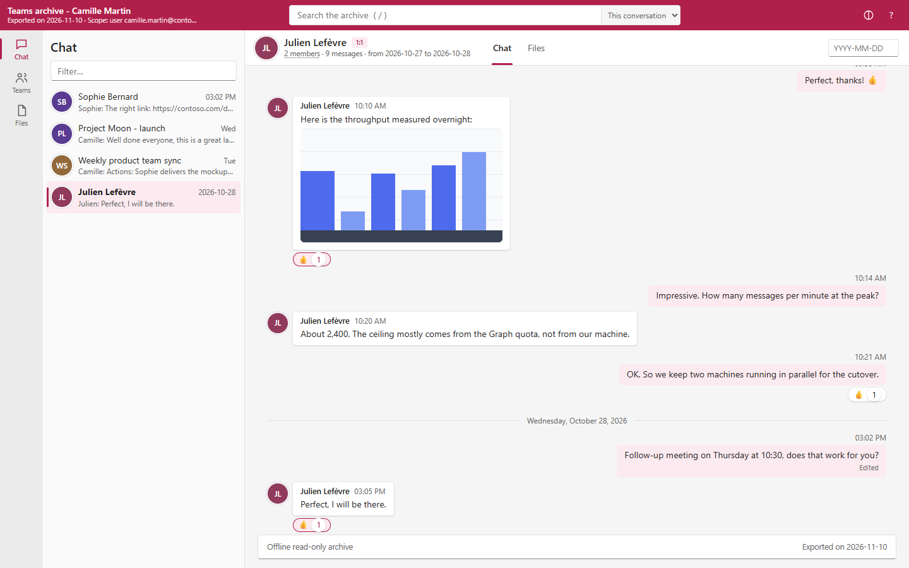
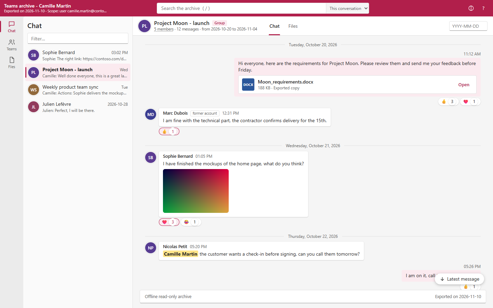
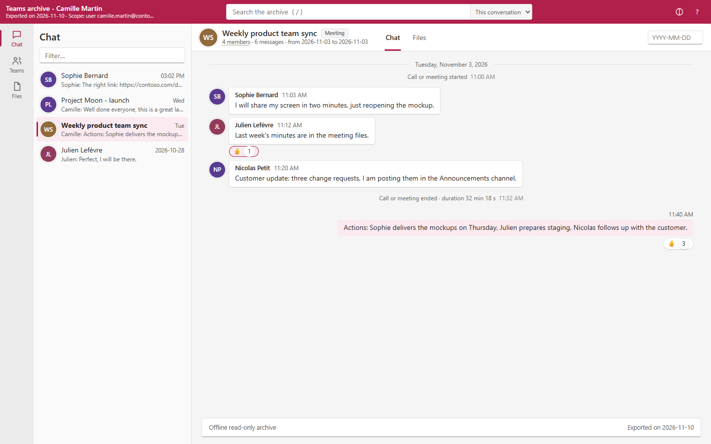
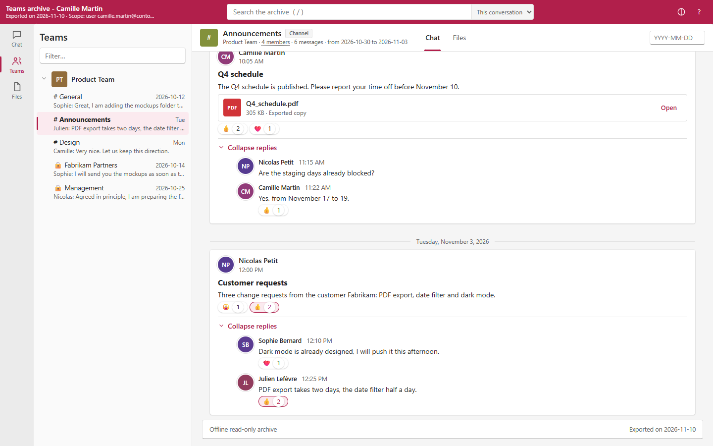
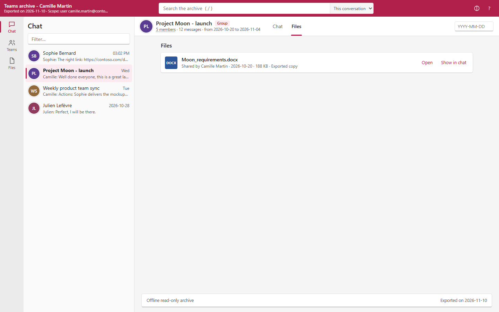
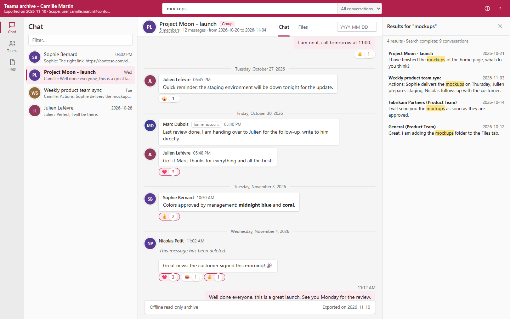
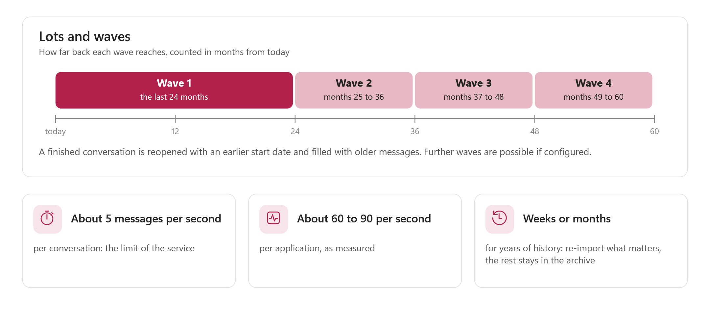
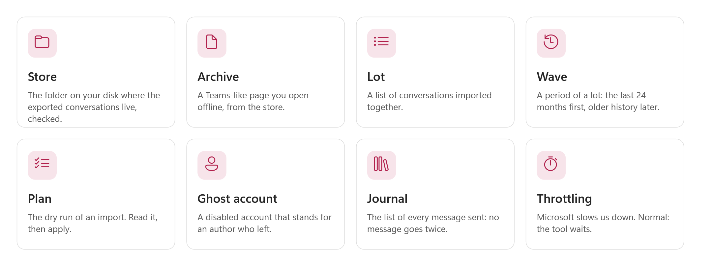

# Teams Transfer — User guide

> Follow the steps one after the other. Each step says **what to do**, **what you should see**, and **what to do if not**. You do not need to know Microsoft Graph or app registrations before you start: every word is explained. How the tool works inside, every setting and the exact permissions are in the [reference guide](TeamsTransfer-Guide.md). It is a second file, `TeamsTransfer-Guide.html`, in the same `docs` folder as this one.

> [!IMPORTANT]
> Files downloaded from the Internet may be blocked by Windows and fail to run. Check the publisher first (right-click `Invoke-TeamsTransfer.ps1`, Properties, Digital Signatures: `Nicolas Fabert`), then unblock every file in the folder:
>
> ```powershell
> Get-ChildItem "D:\Tools\TeamsTransfer-1.0.2" -Recurse -File -Force | Unblock-File
> ```
>
> Replace the example path with the folder where you extracted the package.

> [!WARNING]
> **Stop and ask.** If a step does not go as written, do not guess and do not click again and again. Write down what you see (a photo of the screen is enough) and call your administrator, or the person who gave you this guide. Reading and exporting change nothing in a tenant. **Importing does**: an imported conversation cannot be rolled back.

<!-- icon: flow -->
## 1. What it does and when to use it

### What this tool does

Teams keeps your people's chats and channel posts in the cloud. This tool can **copy them out** of one Microsoft 365 tenant into a folder on a computer you control (the **store**), let you **read them offline**, and **put them back** into a tenant (the same one, or another one) with their original dates, authors, reactions, pictures and files.

Think of moving house. The tool first lists and boxes everything (**export**). You can open any box and look inside without the new house being ready (**browse the archive**). Then you decide which rooms move first, you rehearse on paper (**plan**), you make name tags for people who left (**ghosts**), you move the heavy boxes (**copy files**), and you unpack the rooms one by one (**import**). At the end you walk through both houses and check that nothing is missing (**verify**).

```flow
chart | Estimate | how big is the job
arrow | read |
download | Export | to a local store
arrow | open |
chat | Browse | offline archive
arrow | choose |
layers | Plan | a lot, a wave
arrow | prepare |
upload | Import | ghosts, files, messages
arrow | check |
check | Verify | source against target
```


### When to use it

| Your situation | Use it to |
|---|---|
| **Tenant to tenant.** A company is split, merged or moves to a new Microsoft 365 tenant. | Export from the old tenant, import into the new one. |
| **Restore in the same tenant.** Conversations were lost or must be put back after an incident. | Import the exported copy back into the same tenant. Messages that are already there are not duplicated. |
| **Archive of leavers.** You must keep the conversations of people who left. | Keep the offline archive; optionally import them into archive teams, one channel per departed person. |
| **Just keep a copy.** You only need a readable, searchable copy outside Teams. | Export, then browse the archive. No target tenant is needed. |

### What it cannot do, and what to expect

Read this once. It saves you a bad surprise.

- **An imported conversation cannot be rolled back.** There is no "undo". This is a rule of the Microsoft service, not of the tool. That is why every write step has a preview first.
- **Importing years of history takes months.** Microsoft allows about 5 messages per second in one conversation, and roughly 60 to 90 messages per second for one application. A tenant with billions of messages cannot be copied in a weekend. The tool works in **lots** and **waves**: the last 24 months first, older history later, and what you do not import stays readable in the offline archive. See [chapter 5](#5-lots-and-waves).
- **Deleted authors become ghost accounts.** Microsoft refuses a message written by a deleted account. The tool creates a disabled, unlicensed account named "First Last (former)" for each such person, so the original author is kept. See [chapter 4, Import](#import-a-lot).
- **Meeting chats are imported as group chats**, with the meeting title. The service does not support meeting chats.
- **A chat with a person who left** keeps only one live member, so it is imported as a **group chat with your service account**, titled "Archived chat with <name>". Ghost accounts are never added as members of a chat, channel or team: they only stand for the author of old messages.
- **Federated (external) content cannot be imported.** Its author is replaced by your service account, and the message starts with a line "Original message from ...".
- **Messages imported by the service are invisible to Microsoft's bulk export.** The tool knows it and verifies chat by chat.
- Videos, cross-posts and links generated by SharePoint are outside what the import API supports.

> [!NOTE]
> The new tenant sees imported messages as ordinary messages, with the original author and the original date. The people can read and search them. They cannot "unsend" them.

### The path

You do part A once, then part B for each lot.

```path
Set up once | settings | Get ready, once
Set up once | 1 | Get your rights | ask your administrator (chapter 2)
Set up once | 2 | Put the tool on the PC | unzip, then unblock (chapter 3)
Set up once | 3 | Fill in the settings file | ids and thumbprints
Set up once | 4 | Open the console | all the lights are green (chapter 4)
A | download | Export and read offline
A | 5 | Estimate and inventory | reads only, nothing is changed
A | 6 | Export | 24 months, channels and files
A | 7 | Open the archive | offline, by double-click
B | upload | Import into a tenant
B | 5 | Plan a lot | a dry run: read plan.html
B | 6 | Ghosts, files, messages | a preview first, then -Apply
B | 7 | Verify | read verify.html
```


<!-- icon: checklist -->
## 2. Before you start

Tick every box before you begin. If you cannot tick a box, stop and ask.

- [ ] I have this guide and enough time. An estimate takes minutes, an export hours or days, an import days to months.
- [ ] I know the **two tenants**: the **source** (where the conversations are now) and the **target** (where they will go). For a restore or an archive they can be the same tenant.
- [ ] A **Microsoft 365 administrator** gave me, or created for me, the two app registrations and the certificate (see below).
- [ ] The tool folder is on a computer with a **local disk** big enough for the store (see the box below), and the files are unblocked.
- [ ] I know **which people or teams** go first. A small test (one user) always goes first.
- [ ] I have a **lab tenant**, or at least a test user and a test team, for a full rehearsal.
- [ ] I know who decides what is kept and who may read the archive. The store contains private conversations.
- [ ] I know who to call if I am stuck. Name and phone number: ____________________

> [!NOTE]
> **How much disk?** Messages are compressed. As a rough guide, one billion messages is a few hundred gigabytes of store, and the **files** can be much bigger (several terabytes for a very large tenant). The estimate in [chapter 4](#estimate) gives numbers for your tenant. Use a local disk. A network share is refused on purpose: the database inside the store is corrupted by network shares.

### Who does what

| Person | What they do |
|---|---|
| **The Microsoft 365 administrator** | Creates the app registrations, uploads the certificate, grants the permissions (consent), creates the service account, and, if Microsoft asks for it, requests access to the Teams protected APIs. |
| **The operator** (you) | Runs the console, reads the plans and the reports, decides when to press **Apply**. |
| **The owner of the data** | Decides the scope, who may read the archive, how long the store is kept. |

### What an app registration is

An **app registration** is an identity for a program. It lets the tool sign in to Microsoft 365 **without a person at the keyboard**, with exactly the rights you give it and no more. It signs in with a **certificate** (a digital key with an end date) instead of a password, so there is no secret to leak or to type.

You need **two** app registrations, one per side. The source one only **reads**. The target one **writes**. Keeping them apart means the tool can never write to the source tenant.

| | Source app (Reader) | Target app (Writer) |
|---|---|---|
| Used for | Estimate, Export, Files | Plan, Ghosts, Copy files, Import, Verify |
| Writes to a tenant? | **Never** | Yes, but only after you press Apply |
| Suggested name | `TeamsTransfer Reader` | `TeamsTransfer Writer` |

### Step A · Create the certificate

You can use one certificate for both apps, or one per app (cleaner). Do this on the computer that will run the tool, in PowerShell 7. It creates a certificate whose private key **never leaves** this computer, and saves only the public part to a file.

```powershell
$cert = New-SelfSignedCertificate -Subject 'CN=TeamsTransfer-Reader' -CertStoreLocation Cert:\CurrentUser\My `
    -KeyAlgorithm RSA -KeyLength 2048 -HashAlgorithm SHA256 -KeySpec Signature `
    -KeyExportPolicy NonExportable -KeyUsage DigitalSignature -NotAfter (Get-Date).AddYears(1)
Export-Certificate -Cert $cert -FilePath D:\TeamsTransfer-Reader.cer | Out-Null
$cert.Thumbprint
```

**You should see:** a long line of letters and digits. That is the **thumbprint**. Write it down: it goes in the settings file. The file `D:\TeamsTransfer-Reader.cer` is the **public** part. It is safe to send to the administrator.

**Repeat** with `CN=TeamsTransfer-Writer` and `D:\TeamsTransfer-Writer.cer` for the target app.

> [!CAUTION]
> Never export the private key (`.pfx`) and never send it by e-mail. The certificate ends in one year: write the end date in your calendar. A tool run by a scheduled task under another account needs the certificate in `Cert:\LocalMachine\My`, with read access to its key for that account.

### Step B · Create the source app registration (Reader)

The administrator does this in the **Microsoft Entra admin center** (`entra.microsoft.com`), signed in to the **source** tenant.

1. Open **Identity**, then **Applications**, then **App registrations**, then **New registration**.
2. **Name:** `TeamsTransfer Reader`. **Supported account types:** *Accounts in this organizational directory only* (single tenant). Leave **Redirect URI** empty. Click **Register**.
3. On the **Overview** page, copy two values: **Application (client) ID** and **Directory (tenant) ID**.
4. Open **Certificates & secrets**, then the **Certificates** tab, then **Upload certificate**. Choose `TeamsTransfer-Reader.cer`. Do **not** create a client secret.
5. Open **API permissions**, then **Add a permission**, then **Microsoft Graph**, then **Application permissions** (not *Delegated*). Search and tick each permission of the table below, then click **Add permissions**.
6. Click **Grant admin consent for** your tenant, and confirm. Every line must now show a green check and *Granted for ...*.

**Permissions of the source app (Reader), application type:**

| Permission | In plain words |
|---|---|
| `User.Read.All` | read the list of people (and deleted people) |
| `Chat.Read.All` | read the chats and their messages |
| `Chat.ReadBasic.All` | list the chats of every person (`Chat.Read.All` also covers it) |
| `ChatMember.Read.All` | read who is in each chat |
| `ChannelMessage.Read.All` | read the posts and replies of channels |
| `Team.ReadBasic.All` | list the teams |
| `TeamMember.Read.All` | read who is in each team |
| `Channel.ReadBasic.All` | list the channels of a team |
| `ChannelMember.Read.All` | read who is in each channel (private and shared channels too) |
| `Files.Read.All` | download the files that messages refer to |
| `Sites.Read.All` | read the SharePoint libraries where channel files live |

> [!NOTE]
> **Wait 2 to 5 minutes** after the consent before you try the tool. Microsoft needs a moment.
>
> **If you later see "403" or "protected API":** reading all the chats and channel posts of a tenant with an application is covered by Microsoft's Teams *protected APIs*. In a tenant where this is enforced, Microsoft asks you to request access first (the request form is linked from the Microsoft Learn page *Overview of Microsoft Teams protected APIs*). The consent alone is then not enough. Ask your administrator to check the current rule early: an approval can take days.

### Step C · Create the target app registration (Writer)

Same steps, in the **target** tenant: name `TeamsTransfer Writer`, upload `TeamsTransfer-Writer.cer`, copy the two ids.

**Permissions of the target app (Writer), application type:**

| Permission | In plain words |
|---|---|
| `Teamwork.Migrate.All` | the right to *import* messages with their original dates and authors |
| `Chat.Create` | create chats |
| `Chat.ReadWrite.All` | read and write chats |
| `Chat.Read.All` | read chats back (plan and verification) |
| `ChatMember.ReadWrite.All` | manage who is in a chat |
| `Channel.Create` | create channels |
| `ChannelMember.ReadWrite.All` | manage who is in a channel |
| `Team.Create` | create teams (archive teams, or a team that does not exist yet) |
| `TeamMember.ReadWrite.All` | manage who is in a team |
| `Team.ReadBasic.All` | look teams up by name |
| `Channel.ReadBasic.All` | read the state of a channel during an import |
| `ChannelMessage.Read.All` | read channel messages back for the verification |
| `User.Read.All` | find the target person for each source person |
| `User.ReadWrite.All` | create the **ghost accounts** (only if you use ghosts) |
| `Group.Read.All` | find the ghost tracking group |
| `GroupMember.ReadWrite.All` | add ghosts to the tracking group |
| `Files.ReadWrite.All` | put files in OneDrive and in channel folders, and share them |
| `Sites.ReadWrite.All` | write in the SharePoint libraries of channels |

> [!NOTE]
> Two optional extras. `Group.ReadWrite.All` instead of the two `Group` lines above lets the tool **create** the ghost tracking group itself (`-CreateTrackingGroup`). `User.DeleteRestore.All` is needed only to **purge** removed ghosts (`-Purge`). Skip both unless you need them. The reference guide, [chapter 5](TeamsTransfer-Guide.md#5-minimum-permissions-per-mode), says which mode needs which permission, so you can grant less for a smaller job.

### Step D · Prepare the target tenant

| What | Why | Example |
|---|---|---|
| **A service account** in the target tenant | It is the fallback author for external and deleted people, and the owner of created teams. It is a normal user account. | `svc-migration@fabrikam.com` |
| **A domain for ghost accounts** | A verified domain of the target tenant, or its `onmicrosoft.com` name. | `fabrikam.com` |
| **The people exist in the target** | The plan maps each source person to a target person. People who do not exist yet must be created first (or become ghosts or service-account messages). | `camille.martin@fabrikam.com` |
| **OneDrive for the people** | Files of a chat are copied to the sender's OneDrive. A person who never signed in may have none yet. | provision it in advance |
| **A mapping file**, if the names differ | A CSV `SourceUpn,TargetUpn` for people whose address changed. | see [chapter 5](#5-lots-and-waves) |

### The settings file

The tool never stores a secret. It stores **names and numbers** only: tenant ids, application ids, certificate thumbprints. You write them in a private file, `config\TeamsTransfer.config.local.psd1`, that is never part of the release. You will fill it in chapter 3.

<!-- icon: download -->
## 3. Install

You do this part **one time**.

### 1 · Put the tool on the computer

**Do:**

1. Create the folder `D:\Tools` (any local folder with restricted access works).
2. Extract the whole release ZIP into it. The ZIP holds one folder, so this creates `D:\Tools\TeamsTransfer-1.0.2`: that is the tool folder used in the rest of this guide.
3. Open **PowerShell 7**: click the Windows **Start** button, type `PowerShell 7`, right-click it, choose **Run as administrator** only if you installed the folder in a protected place.
4. Check the publisher: right-click `Invoke-TeamsTransfer.ps1`, **Properties**, **Digital Signatures**. The signer must be `Nicolas Fabert`.
5. Unblock the files:

```powershell
Get-ChildItem D:\Tools\TeamsTransfer-1.0.2 -Recurse -File -Force | Unblock-File
```

**You should see:** the window comes back with a new empty line. No message means it worked.

**If not:** if Windows says that `PowerShell 7` does not exist, ask your administrator to install it. It is a free program from Microsoft. Windows PowerShell 5.1 (the older program, with a dark blue window) does **not** work with this tool. The version is checked with `pwsh -v` (it must be 7.4 or later).

> [!NOTE]
> A **release** package is signed by its owner and checked before anything runs. A source checkout, or a development package without that signature, starts only if you add `-DevelopmentMode`, and the tool says so every time. Do not try to work around the check: if it stops with *Package integrity*, extract the release ZIP again and unblock it.

### 2 · Choose the store folder

The **store** is where the exported conversations live. It must be on a **local disk of this computer**, outside the tool folder. Create it, for example, with `New-Item -ItemType Directory D:\ttstore`.

### 3 · Fill in the settings file

**Do:** create the private settings file. Copy this line into PowerShell and press **Enter**:

```powershell
notepad D:\Tools\TeamsTransfer-1.0.2\config\TeamsTransfer.config.local.psd1
```

Paste this text, replace the values between the quotes with yours (the ids and thumbprints you wrote down in chapter 2), save, and close Notepad:

```powershell
@{
    Source = @{
        Cloud                 = 'Global'
        TenantId              = 'contoso.onmicrosoft.com'
        ClientId              = '11111111-1111-1111-1111-111111111111'
        CertificateThumbprint = 'AAAAAAAAAAAAAAAAAAAAAAAAAAAAAAAAAAAAAAAA'
    }
    Target = @{
        Cloud                 = 'Global'
        TenantId              = 'fabrikam.onmicrosoft.com'
        ClientId              = '22222222-2222-2222-2222-222222222222'
        CertificateThumbprint = 'BBBBBBBBBBBBBBBBBBBBBBBBBBBBBBBBBBBBBBBB'
        ServiceAccountUserId  = 'svc-migration@fabrikam.com'
    }
    Store  = @{ Path = 'D:\ttstore' }
    Output = @{ Root = 'D:\ttout' }
    Ghosts = @{ DomainName = 'fabrikam.com' }
}
```

| Line | What to write | Example |
|---|---|---|
| `Cloud` | `Global` for the normal Microsoft 365 cloud. The other values are `USGov`, `USGovDoD` and `China`. | `Global` |
| `TenantId` | the **Directory (tenant) ID** you copied, or the `onmicrosoft.com` name | `contoso.onmicrosoft.com` |
| `ClientId` | the **Application (client) ID** of that side's app registration | a 36-character id |
| `CertificateThumbprint` | the thumbprint of the certificate of that side | 40 letters and digits |
| `Store.Path` | the store folder of step 2 | `D:\ttstore` |
| `Output.Root` | where logs and reports go. A relative path is resolved next to the tool folder (in `<parent>\out`), never inside it. An absolute path on a local disk is best | `D:\ttout` |
| `Ghosts.DomainName` | the domain of the ghost accounts (target tenant) | `fabrikam.com` |
| `ServiceAccountUserId` (in `Target`, optional) | the service account of step D, so you do not have to type it each time | `svc-migration@fabrikam.com` |

**You should see:** the file saved. Nothing else happens.

**If not:** if a message later says the settings file cannot be read, open it again and look at the line it names. A quote or a bracket is missing, most of the time. A `.psd1` file holds data only: the tool never runs it as a program.

> [!CAUTION]
> Never write a password, a secret or a private key in this file. If you ever see a line that asks for one, stop and ask.

### 4 · Open the console

**Do:** double-click `Start-TeamsTransferConsole.cmd` in the tool folder. Or copy this line into PowerShell and press **Enter**:

```powershell
pwsh -STA -File D:\Tools\TeamsTransfer-1.0.2\Invoke-TeamsTransfer.ps1 -Gui
```

**You should see:** the console opens on the **Setup** page. If you want to look around first without any tenant, add `-Demo`: the console then uses made-up tenants and a temporary store (a yellow **DEMO** badge is always shown).

**If not:** if a message says the console libraries are missing, the package is incomplete: extract the complete release ZIP again. If it says WebView2 is missing, install the *Microsoft Edge WebView2 Runtime* from Microsoft. The console keeps working, only the built-in preview is missing, and you can open the archive in your browser instead.

<!-- icon: terminal -->
## 4. The console, step by step

The console has **five steps**, always in the same order. The bar at the top shows where you are. Every task goes through the same five pages, so once you know one you know them all.

| Step | The page | You do |
|---|---|---|
| **1 Setup** | Setup | check the lights, the store and the settings file |
| **2 Task** | Task | choose what to do, and on what |
| **3 Verify** | Verify | read the checks; for an import, read the preview and decide |
| **4 Run** | Run | watch the work; stop it if needed |
| **5 Next steps** | Next steps | read the result, the exact command, the reports, and what to do next |

> [!TIP]
> **Every run is also an ordinary command.** The Verify and Next steps pages show the exact command line of what you are about to run or just ran. Copy it to a script or a scheduled task. The console and the command line are the same engine.

### 1 · Setup

**Do:** look at the page. Nothing to type if the settings file is filled in.

![The Setup page, with the yellow banner "Demo mode: Synthetic tenants (Contoso to Northwind) and a temporary store: nothing leaves this machine". The five-step bar (1 Setup selected). A STORE box with the path D:\TeamsTransfer\store, the message "No store at D:\TeamsTransfer\store yet: the export creates it", the buttons Choose a folder... and Check again; the Configuration box (D:\TeamsTransfer\package\config\TeamsTransfer.config.psd1) with Browse... and Reload; the buttons Open the local override, Open the log folder and Open the reports folder. Two boxes, SOURCE TENANT (contoso-demo) and TARGET TENANT (northwind-demo), each with a green light, its application and certificate, "All permissions present", a Permissions drop-down and a Check permissions button. At the bottom right, Choose a task.](images/console-setup-light.png)

Here is what the page shows.

| Part | In plain words |
|---|---|
| **Store** | the folder of the exported conversations. *No store yet: the export creates it* is normal on the first day. **Check again** reads it again. |
| **Configuration** | the settings file in use. **Browse...** picks another one. **Reload** reads it again. |
| **Open the local override**, **Open the log folder**, **Open the reports folder** | shortcuts to the file you edited and to the folders where the logs and the reports go. |
| **Source tenant** and **Target tenant** | a **light**, then the tenant, application and certificate. A **green** light with *All permissions present* means the application holds every permission the console knows it needs. **Permissions** shows the list. **Check permissions** asks the tenant again. |

**You should see:** two green lights. A **grey** light, *Not configured*, means that side is not filled in the settings file. You only need the source for an estimate or an export, and the target for an import or a verification. An **amber** light means the side is configured but the permissions were not checked yet: press **Check permissions**.

**If not:** a **red** light says what is missing. Read the red text. Typical causes are a wrong id, a certificate that is not on this computer, a permission that was not consented. Ask your administrator, then press **Check permissions**.

Press **Choose a task** when you are ready.

### 2 · Choose a task

The console offers five tasks, as five cards. Click one. The card turns pink.


| Card | In plain words | Writes to a tenant? |
|---|---|---|
| **Estimate** | Samples the source and tells you how big the job is. | No |
| **Export conversations** | Copies chats, channels and files into the store. | No (the source is only read) |
| **Browse the archive** | Opens the exported conversations in a Teams-like viewer, offline. | No |
| **Import a lot** | Plans, then (only after your preview and your Apply) creates ghosts, copies files and imports messages. | **Yes, only after Apply** |
| **Verify a lot** | Compares the target with the source and writes the reports. | No (the target is only read) |

The grey card **What will happen** always says, in one sentence, exactly what the next run will do and whether it writes anything. **Read it every time.**


### Estimate

Use it first, on every project. It reads a **sample** of users, measures their messages and files, and extrapolates to the whole tenant: how many messages, how much disk, how long the export and the import will take, and how many waves.

#### 2 · Task: Estimate

**Do:** click **Estimate**. Choose how many users to sample (**Users to sample**, default 20) and, if you want channel messages counted too, how many teams (**Teams to sample**, default 0 means none). **More options** has the depth of history to extrapolate over (default 60 months).


**You should see:** the sentence in the grey card names the source tenant and says *Nothing is written to any tenant*.

**If not:** if the button stays grey, go back to Setup: the source side is not configured.

Click **Continue to verification**.

#### 3 · Verify: Estimate

**Do:** read the check list. Then click **Start estimate**.


**You should see:** a green dot and **OK**. The command at the bottom is `.\Invoke-TeamsTransfer.ps1 -Mode Assess ...`.

**If not:** a red line names what is missing, for example a permission. Fix it and come back.

#### 4 · Run: Estimate

**Do:** wait. Do not close the window.

![The Run page for the estimate, "Done" (green pill): "Run · contoso-demo (synthetic) · started 22:32 on ADMIN-WS01", a full progress bar and "1 step(s) · 1.4 s". Left, "Steps (1, all known before the start)": 1. Sample the source tenant, with a check. Middle, the step with the chips users 4, sampled 4, chats 4, messages 31, errors 0, "Nothing to report so far." and two folds, Technical message and Activity log. Right, the journey, the report path D:\TeamsTransfer\reports\2026-11-10_223205_Assess with Open folder and Copy path, and Warnings: None. Button: What next?](images/console-run-estimate-light.png)

**You should see:** three columns. On the left, the **steps** of the run, known before it starts, each with a check when it is done. In the middle, the **result** of the step in chips (here: users, sampled, chats, messages, errors) and a **Warnings and errors** box. On the right, the **journey**, the **report** folder (**Open folder**, **Copy path**) and the warnings. Two folds, **Technical message** and **Activity log**, hold the details for your administrator.

**If not:** a step in red means the run stopped on purpose at the first error. Do not click anything: take a photo and read [chapter 7](#7-messages-and-what-to-do). Nothing is lost: you can run it again.

Click **What next?**.

#### 5 · Next steps: Estimate


**Do:** open the report (**Open 2026-..._Assess**). It is a web page: read the estimate of volume, disk, duration and waves.

**You should see:** *Estimate: done*, the counters, and a pink button **Export conversations** that takes you to the next task. **Start another task** goes back to the choice.

> [!NOTE]
> An estimate is a **sample**, extrapolated. *Sample errors* in the result mean the estimate may be low. Use the numbers to size the project and to choose the size of your lots, not as a promise.


### Export

Export copies the conversations from the source tenant into the store. It **only reads** the source. It can be stopped and started again any time: a second run reads only what changed.

#### 2 · Task: Export

**Do:** click **Export conversations**. Under **On what?** choose one:

| Choice | In plain words |
|---|---|
| **Single user (test)** | One person. **Always start here.** Type the address (`camille.martin@contoso.com`). |
| **Users from a CSV** | A list of people in a CSV file with a column `Id`, `Identity` or `UserPrincipalName`. |
| **A team** | A team by its exact name or id. |
| **Existing lot** | The people and teams of a lot that already exists. |
| **Everyone in the store** | Every person already listed in the store (after an inventory). |

**More options** has the **Period** (empty means the whole history; `24m` means the last 24 months, or write `2024-01-01..2025-12-31`), **Include the channels** and **Download the files too** (both ticked by default), and **Read everything again**.

![The Task page with the Export conversations card selected and "Single user (test)" chosen: a User box with camille.martin@contoso.com (hint "UPN or id, comma separated"), a More options fold, and the grey card "Reads the chats, channels of user camille.martin@contoso.com from the SOURCE tenant contoso-demo (synthetic) (read only) into the local store D:\TeamsTransfer\store, with their files. Nothing is written to any tenant." The bar reads "Export conversations · user camille.martin@contoso.com · DEMO".](images/console-task-light.png)

**You should see:** the grey card names the user, the source tenant, the store folder and *Nothing is written to any tenant*. (The next pictures of this task were taken with the scope **Everyone in the store**, which is why their commands carry `-AllStoreUsers`.)

Click **Continue to verification**.

#### 3 · Verify: Export


**Do:** read the two checks, then click **Start export conversations**.

**You should see:** two green **OK**. Below, three commands: an export is really three steps in a row, **Inventory** (list who and what exists), **Export** (the messages), **Files** (the files that messages refer to).

**If not:** if the store check is red, the folder is on a network share or inside the tool folder. Choose another one in **Setup**.

#### 4 · Run: Export

![The Run page for the export, "Done": "started 22:32 on ADMIN-WS01", "3 step(s) · 2.5 s". Left, three steps with checks: 1. Inventory (773 ms), 2. Export the messages (1.2 s), 3. Download the files (428 ms). Middle, the chips files 0, deduplicated 0, failed 0. Right, the journey: Inventory "users 4, chats 4, teams 1", Export the messages "conversations 0, messages 114, new 47", Download the files "files 0, deduplicated 0, failed 0"; the report path D:\TeamsTransfer\reports\2026-11-10_223216_Files. Button: What next?](images/console-run-export-light.png)

**Do:** wait. A real export of a large tenant takes hours or days. You can leave the window open and come back. **Stop** (or Ctrl+C on the command line) ends the run cleanly after the requests in flight; the state is saved.

**You should see:** each step turns into a green check, with its numbers. While it runs you see lines such as the number of messages and the throughput. If Microsoft slows the tool down (**429** or **503**), the tool waits exactly as long as Microsoft asks and lowers its speed: this is normal and nothing to fix.

**If not:** orange warnings are not errors. *Files not copied: n not found, n forbidden, n too large* means some files were deleted, are not readable, or are above your size limit. *n unit(s) failed ... retried by the next run* means run it again. See [chapter 7](#7-messages-and-what-to-do).

#### 5 · Next steps: Export


**You should see:** *done*, the counters (messages, **new** and **updated**), and two buttons: **Browse the archive** (recommended) and **Import a lot**. The three report buttons open the Inventory, Export and Files reports.

**Do:** click **Browse the archive**. Check a few conversations before going on.


### Browse the archive

The archive is the Teams-like viewer on what you exported. It works **offline** and is **read only**: no tenant is contacted. Use it to check the export, to answer "was that said?", and to keep what you will not import.

#### 2 · Task: Browse the archive

**Do:** click **Browse the archive**. There is nothing to choose: the grey card says which store will be opened. Click **Continue**.


#### 3 · Verify: Browse


**You should see:** the counters of the store and two green checks. If you see *Nothing exported yet: Run Export first*, go back to Export.

Click **Open the viewer**.

#### 4 · Run: the Explorer

![The Explorer page ("Read the exported conversations as in Teams. The preview is the offline HTML archive generated from the store."). On the left, a search box "Search users and conversations", the buttons Users and Conversations (Conversations selected) and the list: two one-to-one chats of Camille Martin, the meeting "Weekly product team sync", the group "Project Moon - launch" (selected) and the channels Product Team / Design, General, Fabrikam Partners, Management and Announcements; "9 found". On the right, "Project Moon - launch - 12 message(s)" with the buttons Open archive folder and Open in browser, and the archive in the built-in viewer. Buttons: Back and What next?](images/console-explorer-light.png)

**You should see:** on the left, **Users** and **Conversations**. Pick a person to see all their conversations, or one conversation. The right side is the archive itself. **Open archive folder** shows the files on disk. **Open in browser** opens the same archive in your normal browser. Links that leave the archive **ask before they open**.

**If not:** if a message says the archive was built but cannot be shown (WebView2), click **Open in browser**.

#### What the archive looks like

The archive looks like Teams on purpose, but it is plain HTML made by this tool, with no Microsoft logo and no network access. You read it like this.


**A chat.** Your own messages are on the right, the others on the left, with day separators, reactions, **Edited** marks, pictures and file cards. A deleted message shows *This message has been deleted*.



**A group chat.** The people who left are tagged **former account**.



**A meeting chat.** Call and meeting events (started, ended, duration) are shown as lines.



**A channel.** Posts with their replies, folded or open, in the **Teams** rail. Private and shared channels show a lock.



**Files.** The **Files** tab of a conversation lists every file with **Open** and **Show in chat**.



**Search.** Type in the top bar. Choose **This conversation** or **All conversations**. Results show the match highlighted. Press `/` to jump to the search box.



> [!TIP]
> To hand an archive to somebody, use the command line: `-Mode Archive ... -SingleFile -OutputPath D:\archives\camille.html` writes **one self-contained file** that opens by double-click, with no network. It contains full conversations: protect it like the store. See [chapter 6](#6-running-it-from-the-command-line-and-in-a-scheduled-task).


### Import a lot

This is the only task that writes to a tenant. It is a chain of four jobs. The console runs them for you, in order, and **asks before every write**.

```flow
layers | Plan | a rehearsal on paper
arrow | then |
key | Ghosts | name tags for people who left
arrow | then |
file | Copy files | the heavy boxes first
arrow | then |
upload | Import | the messages, in their old dates
```

| Job | In plain words | Writes to the target? |
|---|---|---|
| **1 · Plan** | A **dry run**. It decides where every conversation goes, who writes what, which files must be copied, what blocks, and how long it will take. It writes a report (`plan.html`) and notes **on this computer only**. | No |
| **2 · Ghosts** | For each author who was **deleted** at the source, creates one **disabled, unlicensed** account named "First Last (former)". It cannot sign in. Same person, same ghost, for the whole project. | Yes, only with Apply |
| **3 · Copy the files** | Uploads the files the messages refer to, into the OneDrive of the sender (or the channel folder), and shares them with the chat members. | Yes, only with Apply |
| **4 · Import** | For each conversation: opens it, adds each message at its **original date and author**, closes it. A **journal** records every message, so a message is **never sent twice**, even after a crash. | Yes, only with Apply |

After the import, the console copies once more the files of conversations that did not exist before.

#### 2 · Task: Import a lot

**Do:** click **Import a lot**. Choose **On what?**: **Single user (test)**, **Users from a CSV**, **A team**, or **Existing lot**. **More options** holds the rules that map people and teams from the source to the target:

| Option | In plain words | Example |
|---|---|---|
| **Domain rule** | `a@source.com` becomes `a@target.com` | `contoso.com=fabrikam.com` |
| **Service account** | fallback author for external and deleted people; owner of created teams | `svc-migration@fabrikam.com` |
| **Ghost domain** | domain of the ghost accounts | `fabrikam.com` |
| **User mapping (CSV)** | one row per person whose address changed (`SourceUpn`, `TargetUpn`) | a file |
| **Team mapping (CSV)** | one row per team that goes to another name (`SourceTeam`, `TargetTeam`) | a file |
| **Window (new lot)** | how much history the new lot covers: `24m`, `36m`, `48m` or `60m` | `24m` |
| **Waves** | which wave to import now: 1 is the last 24 months; 2, 3, 4 are older | `1` |
| **Scenario** | `TenantToTenant` (default), `SameTenantRestore`, or `DepartedArchive` | `TenantToTenant` |
| **Deleted authors** | `Auto`, `Ghost` or `ServiceAccount` | `Auto` |
| **Create the ghost tracking group** | let the tool create the group "TeamsTransfer - Ghost accounts" if it is missing | ticked |

![The Task page with the Import a lot card selected and "Single user (test)" chosen. The choices are Single user (test), Users from a CSV, A team and Existing lot (no "Everyone in the store"). A User box with camille.martin@contoso.com, a More options fold, and the grey card "Plans the import of user camille.martin@contoso.com, then, only after your preview and your explicit Apply, creates the ghost accounts, copies the files and imports the messages into the TARGET tenant northwind-demo (synthetic). Until then nothing is written to any tenant."](images/console-task-import-light.png)

**You should see:** *Until then nothing is written to any tenant.*

**Start with a single user or one small team.** A lot is created for what you choose. The console names it for you (for example `plan-20261110-191611`, the date and time of the plan); on the command line you can name it yourself with `-Lot` (chapter 5).

Click **Continue to verification**.

#### 3 · Verify: Import (the preview)

The Verify page does the **plan** and the **preview**. Nothing is written yet.

![The Verify page titled "Preview the import before anything is written", with the pill "Preview · nothing is written". Counters: Users 6, Conversations 9, Exported messages 47, Lots 0. "Checks before import a lot": The store is open; 47 exported message(s) to plan; Target tenant: permissions for this task (all OK). Four command lines: -Mode Plan (with -DomainMap contoso.com=northwind.com -GhostDomain northwind.com -Scenario TenantToTenant -ServiceAccount svc-migration@northwind.com -Slices 1 -Users camille.martin@contoso.com), -Mode Ghosts, -Mode CopyFiles and -Mode Import. Buttons: Back and Run preview.](images/console-verify-import-light.png)

**Do:** read the checks and the four commands (the console will run them in this order), then click **Run preview**.

**You should see:** after a moment, the plan result.

![The preview done: pill "Preview done · nothing is written yet". Five tiles: Conversations 9 (Planned), Messages to import 43 (Planned), Ghost accounts 1 (At Apply), Files to copy 3 (At Apply), Blockers 0 (OK). The checks: The store is open, 47 exported message(s) to plan, Target tenant: permissions, "The plan has no blocker" (all OK), then two orange lines marked At Apply: "1 ghost account(s) will be created for deleted authors" and "3 file(s) to copy". Below, "Requests that would be sent": the calls with their counts (GET /chats/{chatId} 8, GET /teams/{teamId} 5, GET .../channels/{channelId} 10, POST /chats 4, .../completeMigration 4, POST /chats/{chatId}/messages 25, .../startMigration 4, POST /teams 5, ...). The button Apply now is grey.](images/console-verify-import-preview-light.png)

How to read it:

| Part | What it tells you |
|---|---|
| **Conversations** and **Messages to import** | what the lot holds for this wave. Messages not imported (system events, deleted messages) are counted apart in the plan. |
| **Ghost accounts** | how many accounts the Ghosts job would create (in the picture: 1, for a deleted author, shown *At Apply*). Above 5,000 the plan is **blocked** until you confirm the number. |
| **Files to copy** | the files the messages refer to (in the picture: 3). *At Apply* means they are copied only when you apply. |
| **Blockers** | **Must be 0.** A blocker stops the import. Typical blockers: people with no target and no rule, ghosts above the threshold, no service account where one is needed. The plan lists each one; fix it and run the preview again. |
| **Requests that would be sent** | the exact calls, counted per endpoint (for example `startMigration`, `messages`, `completeMigration`). The first payloads are kept in the plan, with private values hidden. |

**Open the plan report** (`plan.html`, from **Next steps** or the reports folder) and read it. It lists **who will be a ghost**, **who becomes the service account**, **which teams will be created**, the files, and the **estimated duration**. A warning *Estimated import duration n days ... consider a narrower lot or window* is Microsoft's speed limit speaking, not a bug.

**If not:** with blockers, the **Apply** tick stays off. Read each blocker (see [chapter 7](#7-messages-and-what-to-do)), correct the mapping or the options, and run the preview again.

#### Apply

When, and only when, you have read the plan and are sure, tick the box **Apply: write to tenant ...**.

![The preview page scrolled down: the end of the request list (including POST /teams/{teamId}/channels/{channelId}/messages 6 and .../replies 10), then the box "Apply: write to tenant northwind-demo (synthetic)" now ticked, with "Creates the ghost accounts, copies the files and imports the messages into this tenant. You will be asked to confirm. An imported conversation cannot be rolled back." Under it the four command lines. The bottom bar says "Applying writes to the target tenant northwind-demo (synthetic)." and the button Apply now is active.](images/console-verify-import-apply-light.png)

**Do:** tick **Apply**. The button at the bottom changes from grey **Apply now** to active. Click it, then **confirm** the question that follows.

**You should see:** the Run page.

**If not:** if you are not sure, **do not tick**. Close the console. Nothing was written.

> [!CAUTION]
> **Apply is the point of no return** for the conversations it imports. Be sure of the target tenant (its name is on the button and in the grey card), of the lot, and of the wave.

#### 4 · Run: Import

![The Run page for an import, "Done": "Import a lot · lot plan-20261110-213238", "Apply · northwind-demo (synthetic) · started 22:32 on ADMIN-WS01", "5 step(s) · 00:02:05". Left, five steps: 1. Plan the import (1.2 s), 2. Ghost accounts (1.8 s), 3. Copy the files (1.5 s, with a half-filled orange circle), 4. Import the messages (00:02:01), 5. Copy the files of the new conversations (424 ms, selected). Middle, the chips files 3, uploaded 0, reused 0, shared 0, skipped 0, failed 0, bytes 0 B. Right, "Lot plan-20261110-213238 · user camille.martin@contoso.com" and the journey: Plan the import "conversations 9, messages 43"; Ghost accounts "candidates 1, created 1, linked 0"; Copy the files "files 3, uploaded 2, reused 0"; Import the messages "items 9, imported 43, already 0"; Copy the files of the new conversations "files 3, uploaded 0, reused 0"; the report path and the first warnings (a shared channel, 1 ghost account, 1 author falling back to the service account). Button: What next?](images/console-run-import-light.png)

**Do:** wait. A large lot takes days. You can stop it (**Stop**) and run it again later: it continues where it stopped.

**You should see:** five steps with green checks (in the picture the whole run took 2 minutes 5 seconds for 43 messages). A **half-filled orange circle** on a step means *not finished yet*, for example files that wait for a channel that does not exist yet: the last step copies them once the conversations exist. Orange **warnings** on the right are explained in [chapter 7](#7-messages-and-what-to-do). Two lines you will often see are not errors: *members from other teams or tenants cannot be recreated, only the messages are imported* (shared channels) and *author(s) fall back to the service account*.

**If not:** a red step stops the chain. Read [chapter 7](#7-messages-and-what-to-do), fix the cause, and click the same buttons again: every job is **resumable and idempotent**.

#### 5 · Next steps: Import


**You should see:** the counters (in the picture, nine conversations: 43 messages imported, 4 skipped): **imported** (messages sent), **already** (messages the service already held: counted as imported, never sent twice), **rejected** (messages the service refused: see `rejected.csv`), **skipped** (messages the import cannot create, such as system events, or that were deleted at the source: 47 exported, 43 imported plus 4 skipped), **completed** (conversations closed).

**Do:** click **Verify this lot**.


### Verify

Verify reads the target tenant (read only) and compares it, conversation by conversation, with the journal and the source. Do it after **every** lot.

#### 2 · Task: Verify

**Do:** click **Verify a lot**. Choose the lot in the list (**Lot (imported)**). **More options** has **Messages compared per conversation** (default 10), the **waves**, the **service account** and **Strict counts** (a different number of reactions or files becomes a mismatch).


#### 3 · Verify: Verify


**You should see:** three green checks. The lot is *Completing* after an import.

#### 4 · Run: Verify


#### 5 · Next steps: Verify

![The Next steps page: "Verify a lot: done"; the counters conversations 9, ok 9, mismatch 0, missing 0, notCompleted 0, unverified 0; "What to do next: The lot plan-20261110-213238 matches the source. The reports are ready to keep." with the button Start another task; the two command lines (Verify and Report) with Copy buttons; Reports: Open 2026-11-10_223500_Verify, Open verify.html, Open 2026-11-10_223501_Report, Open TeamsTransfer_Lot_plan-20261110-213238.html and Open verify_plan-20261110-213238.html.](images/console-next-verify-light.png)

**You should see:** the counters (in the picture, nine conversations, all **ok**), and five report buttons. Here is what each result means.

| Result | Meaning | What to do |
|---|---|---|
| **ok** | The conversation matches: counts, authors, dates, a sample of messages, reactions, files, and the migration is closed. | Nothing. |
| **mismatch** | Fewer messages on the target than imported, rejected messages, or an extra message. | Open `verify.csv`, read the detail, fix, run the import of that lot again (a message already there is not duplicated), then verify again. |
| **missing** | The conversation does not exist on the target, or was not created. | Run the import again; read the detail. |
| **notCompleted** | The import of that conversation is not finished (still in migration mode, or messages still pending). | Run the import again, then verify again. |
| **unverified** | The tool could not read the target: a permission is missing. | Grant the permission named in the detail, then verify again. |

When every conversation is **ok**, the lot becomes **Verified**. The reports (`verify.html`, `verify.csv`) are yours to keep as proof.

<!-- icon: layers -->
## 5. Lots and waves

### Why lots

The unit of work of an import is the **conversation**, never the person alone: a group chat belongs to several people and is imported **once**. A **lot** is a list of conversations (chosen by user, by team or from a CSV) and a time **window**. Splitting a big project into lots lets you start small, check, and go on, and lets you stop and resume.

A lot is created by the **Plan** over the conversations already in the store. In the console it gets a name such as `plan-20261110-191611`. On the command line you **name it yourself** with `-Lot wave1` and say who is in it with `-Users`, `-Teams` or a **lot file**: a small CSV with the columns `Type` (`User`, `Team`, `Chat` or `Channel`), `Identity` (the address of the person, the exact name of the team, ...) and, if you want, `Priority` (a number: the lower runs first). Naming a lot twice with the **same** members is fine (it is used as it is); with **other** members it is refused. `-Mode Status` lists the lots with their state.

### Waves: 24 months first, older history later

| Wave | Covers | Default |
|---|---|---|
| **1** | the **last 24 months**, up to now | imported first |
| **2** | months 25 to 36 | later |
| **3** | months 37 to 48 | later |
| **4** | months 49 to 60 | later |



Ask for more at the start with **Window**: a number of months from `1m` to `600m` (for example `36m`, `48m` or `60m`; waves of 12 months follow the first 24). A new lot accepts a number of months only, not a date range. Then import **wave 1** (the default), and, days or weeks later, **wave 2** on the same lot (`-Slices 2` on Plan, CopyFiles and Import), and so on. Microsoft allows a finished conversation to be reopened with an **earlier** start date and filled with older messages: that is what each extension wave does.

> [!NOTE]
> **Export the older history first.** A wave can only import what the store holds. The default export reads the whole history; if you exported only `24m`, export again with a wider period before you plan wave 2.

What you do **not** import stays in the **offline archive**: nothing is lost, it is only not in Teams.

### Several workstations at once

An export can be shared between computers, to go faster (Microsoft's limits are per application, so this helps up to a ceiling). One computer is the **coordinator**.

1. Cut the work in **separate** lot files that do not share any person or team: `ws1.csv`, `ws2.csv`.
2. On each workstation, export its own lot into **its own** store on its own local disk: `-Mode Export -StoreRoot D:\ws1\store -Lot ws1 -LotFile .\lots\ws1.csv -IncludeChannels -IncludeFiles`.
3. When a workstation has finished and nothing writes its store any more, on the coordinator fold its store into the coordinator's: `-Mode Merge -StoreRoot D:\coordinator\store -FromStore \\ws1\share\store`. The other store is only **read**. Do it once per workstation; doing it twice changes nothing.
4. On the coordinator, create the lot over the merged store and plan it with the **same** file: `-Mode Plan -StoreRoot D:\coordinator\store -Lot ws1 -LotFile .\lots\ws1.csv`.

### By user, by team or by CSV

| You want | Use |
|---|---|
| a test with one person | **Single user (test)**, or `-Users camille.martin@contoso.com` |
| a list of people | a CSV with a column `Id`, `Identity` or `UserPrincipalName`: `-Users D:\lots\sales.csv` |
| a team and its channels | `-Teams 'Product Team'` (the exact name, or the id), or a CSV with `Id`, `TeamId` or `DisplayName` |
| a list of people, teams or conversations, with priorities | a lot file: `-Lot wave1 -LotFile D:\lots\wave1.csv`, with the columns `Type`, `Identity`, `Priority` |
| a lot that exists | **Existing lot**, `-Lot wave1` (or the automatic name the console gave) |

A conversation that is already covered for a period by another lot is **not planned again**: the plan warns *n conversation(s) are already covered by another lot*.

### Why it takes time

Three limits of the service, all measured on a real lab:

| Limit | Value | What it means for you |
|---|---|---|
| per conversation | about **5 messages per second** | one conversation of 100,000 messages needs at least 5.5 hours, whatever you do |
| per application and tenant | about **60 to 90 messages per second** in total | the ceiling of the whole project; more workstations do not raise it |
| group chat history | about **15 seconds per member**, per group chat created | budget it for every group chat the import creates |

The tool sends **3 requests at once per conversation** (more only brings *429* answers) and imports many conversations in parallel. It obeys *Retry-After* exactly and slows down by itself.

### How to plan a year

1. **Estimate** with the sample. Read the volume and the number of waves.
2. **Decide the scope** with the data owner: who first (VIPs, active projects), how many months, what stays only in the archive.
3. **Do a lab rehearsal** end to end with a few users: estimate, export, browse, import, verify.
4. **Export everything you may import**, with files, early. Export is not the bottleneck. Run it again before each lot to take the latest messages.
5. **Cut lots of about one day of import** (the plan prints the estimate: about 5 million messages at 60 messages per second).
6. **Import wave 1 lot by lot**, verifying each, ideally in off-hours. Run it in a scheduled task with automatic resume ([chapter 6](#6-running-it-from-the-command-line-and-in-a-scheduled-task)).
7. **Then wave 2, 3, 4**, as time allows. Each is a smaller job than the first.
8. **Watch the end dates**: certificates and app secrets of your own process, and the date when the old tenant goes away. Export once more, last, before it does.

> [!NOTE]
> The only reliable number is the one the **plan** prints for your own lot. A plan that says more than 14 days suggests a narrower lot or window.

<!-- icon: terminal -->
## 6. Running it from the command line and in a scheduled task

Everything the console does is a command. Open PowerShell 7 in the tool folder. Add `-DevelopmentMode` to every command only if the folder is not a signed release.

### The commands, in order

```powershell
# 0. Where am I? (writes nothing)
.\Invoke-TeamsTransfer.ps1 -Mode Status -StoreRoot D:\ttstore

# 1. Estimate
.\Invoke-TeamsTransfer.ps1 -Mode Assess -SampleUsers 30

# 2. List, then export (run again to continue or to take what changed)
.\Invoke-TeamsTransfer.ps1 -Mode Inventory -StoreRoot D:\ttstore
.\Invoke-TeamsTransfer.ps1 -Mode Export -StoreRoot D:\ttstore -Window 24m -IncludeChannels -IncludeFiles

# 2b. Several workstations: export a named lot, merge the stores on the coordinator
.\Invoke-TeamsTransfer.ps1 -Mode Export -StoreRoot D:\ws1\store -Lot ws1 -LotFile .\lots\ws1.csv -IncludeChannels -IncludeFiles
.\Invoke-TeamsTransfer.ps1 -Mode Merge -StoreRoot D:\coordinator\store -FromStore \\ws1\share\store
.\Invoke-TeamsTransfer.ps1 -Mode Plan -StoreRoot D:\coordinator\store -Lot ws1 -LotFile .\lots\ws1.csv

# 3. Browse offline: one file you can send
.\Invoke-TeamsTransfer.ps1 -Mode Archive -StoreRoot D:\ttstore -Users camille.martin@contoso.com -SingleFile -OutputPath D:\archives\camille.html

# 4. Plan (nothing is written to a tenant; exit code 3 means blockers)
.\Invoke-TeamsTransfer.ps1 -Mode Plan -StoreRoot D:\ttstore -Teams 'Product Team' -Window 24m `
    -DomainMap contoso.com=fabrikam.com -ServiceAccount svc-migration@fabrikam.com -GhostDomain fabrikam.com

# 5. Preview, then apply: ghosts, files, messages (use the lot name that Plan printed)
.\Invoke-TeamsTransfer.ps1 -Mode Ghosts    -StoreRoot D:\ttstore -Lot plan-20261110-191611 -GhostDomain fabrikam.com -CreateTrackingGroup
.\Invoke-TeamsTransfer.ps1 -Mode Ghosts    -StoreRoot D:\ttstore -Lot plan-20261110-191611 -GhostDomain fabrikam.com -CreateTrackingGroup -Apply
.\Invoke-TeamsTransfer.ps1 -Mode CopyFiles -StoreRoot D:\ttstore -Lot plan-20261110-191611 -ServiceAccount svc-migration@fabrikam.com -Apply
.\Invoke-TeamsTransfer.ps1 -Mode Import    -StoreRoot D:\ttstore -Lot plan-20261110-191611 -ServiceAccount svc-migration@fabrikam.com
.\Invoke-TeamsTransfer.ps1 -Mode Import    -StoreRoot D:\ttstore -Lot plan-20261110-191611 -ServiceAccount svc-migration@fabrikam.com -Apply

# 6. Verify, then the reports
.\Invoke-TeamsTransfer.ps1 -Mode Verify -StoreRoot D:\ttstore -Lot plan-20261110-191611 -ServiceAccount svc-migration@fabrikam.com
.\Invoke-TeamsTransfer.ps1 -Mode Report -StoreRoot D:\ttstore
```

Rules to remember:

- **A write mode (`Ghosts`, `CopyFiles`, `Import`) is a preview unless you add `-Apply`.** `-WhatIf` always wins over `-Apply`.
- `-Apply` asks one confirmation. In an unattended run, add `-Force`.
- Every run prints numbered steps and ends with a card: the **result** with its exit code, the **counts**, the path of the **log** and of the **report**, and a **Next** line: the command to run next.
- Reports go to `<Output.Root>\reports\<date>_<Mode>\`. The log of the day is `TeamsTransfer_yyyyMMdd.log` (files older than 14 days are deleted).
- **Stop cleanly** with Ctrl+C, or create the file named by `-StopFile`: the requests in flight finish, the state is saved, the exit code is 2. Run the same command again to resume.

### Exit codes

| Code | Meaning | What to do |
|---|---|---|
| **0** | Complete. | Go on. |
| **1** | An error stopped the run. | Read the message and its *Hint*, fix the cause, run again. |
| **2** | Not complete, nothing lost: stopped, or some items failed and will be retried. | **Run the same command again.** |
| **3** | Items in an uncertain state, or the plan has blockers, or messages were rejected, or a verification found mismatches. | Read the report, settle the items (`-Mode Status` lists them), then run again. |

### In a scheduled task

A long export or import is best run unattended. Run it under a **dedicated account** that owns the certificate (in `Cert:\LocalMachine\My`, with the key readable by that account). Use a wrapper that repeats the same command while it answers **2**, up to a limit, and stops when a stop file appears.

```powershell
# D:\Tools\TeamsTransfer-1.0.2\Run-Export.ps1
$stop = 'D:\ttstore\STOP'
for ($try = 1; $try -le 5; $try++) {
    & pwsh -NoProfile -File D:\Tools\TeamsTransfer-1.0.2\Invoke-TeamsTransfer.ps1 -Mode Export -StoreRoot D:\ttstore `
        -IncludeChannels -IncludeFiles -StopFile $stop
    if ($LASTEXITCODE -ne 2 -or (Test-Path $stop)) { break }
}
exit $LASTEXITCODE
```

```bat
schtasks /Create /F /RU "CONTOSO\svc-teamstransfer" /RP * /RL HIGHEST /TN "Teams Transfer - export" /SC DAILY /ST 20:00 /TR "pwsh.exe -NoProfile -File D:\Tools\TeamsTransfer-1.0.2\Run-Export.ps1"
schtasks /Run /TN "Teams Transfer - export"
```

To pause the task for tonight, create the stop file (`New-Item D:\ttstore\STOP`); delete it to allow the next run.

An unattended import is the same with `-Mode Import -Lot <name> -Apply -Force`. Do it only after you ran the same lot by hand, read the plan and checked the result. Never put `-Force` in a command you have not run by hand first.

Only **one** run may write to a store at a time. A second process gets *already open for writing*. Read-only modes (`Status`, `Archive`, `Report`) can run next to it.

<!-- icon: lifebuoy -->
## 7. Messages and what to do

Find what you **see** in the left column. The middle column says what it **means**. The right column says what to **do**. If you are not sure, **stop and ask**. Messages are English, in the console, in the log and in the final card. A message may end with a **Hint**.

### Setup and sign-in

| I see this | It means | Do this |
|---|---|---|
| A **light is red** or grey on **Setup** | That side is missing a setting, a certificate or a permission. | Read the red text. Fix the settings file or ask the administrator. Press **Check permissions**. |
| *Configuration.Source.TenantId is empty: fill it in config\TeamsTransfer.config.local.psd1.* (or `ClientId`, `CertificateThumbprint`, or `Target`) | A value of that side is not written. | Open the local settings file and fill in the line. |
| *Configuration file ... cannot be read as data* | The settings file has a syntax mistake. | Open it and look at the line named. A quote or a bracket is missing. |
| *Certificate ... not found in CurrentUser\My or LocalMachine\My.* | The certificate is not on this computer, or the thumbprint is wrong. | Check the thumbprint. Create or import the certificate on this computer. |
| *Certificate ... was found but has no accessible private key (check the key ACL for this account).* | The account that runs the tool cannot read the key. | Give that account read access to the key, or run the tool under the account that created it. |
| *AADSTS700016*, *AADSTS700022*, *AADSTS700027* or *AADSTS1002...* | The tenant id, the application id or the certificate does not match the app registration. | Check `TenantId` and `ClientId`; check that the **same** certificate is uploaded to the app registration. |
| *403*, *Forbidden*, *Authorization_RequestDenied* or *protected API* | The permission is missing, not consented, or the Teams protected API access is not granted. | Ask the administrator to grant consent. Check the access to the Teams protected APIs. Wait 5 minutes after the consent. |
| *Package integrity: ...* | A file of the package is missing, changed, or not signed. | Extract the **release ZIP** again and unblock it. A source checkout needs `-DevelopmentMode`. |
| *DevelopmentMode (...)*, in yellow | You started an unsigned development tree on purpose. | Fine for a test. Use a signed release for real work. |
| The launcher says *PowerShell 7.4 or later was not found* | PowerShell 7 is not installed. | Ask your administrator to install it. |
| *The console needs an STA thread* | The console was started in a way WPF cannot use. | Start it with `Start-TeamsTransferConsole.cmd` or `pwsh -STA -File ... -Gui`. |
| *Missing ... lib\gui ... Wpf.Ui.dll* | The console libraries are not in the folder. | Use the complete release ZIP. |
| The viewer says it cannot be shown (WebView2) | The WebView2 runtime is missing. | Install it, or click **Open in browser**. |

### Store

| I see this | It means | Do this |
|---|---|---|
| *No store at ...: run -Mode Inventory or -Mode Export first, or check -StoreRoot.* | There is nothing to read there. | Run an export first, or give the right `-StoreRoot`. |
| *The store ... is already open for writing by another process or instance.* | Another run holds the store. | Wait for it to end, or use another store. |
| *Refusing to open the store ...: it is inside the package folder* | The package folder is replaced at every upgrade. | Choose a folder outside it. |
| *Refusing to open the store ...: SQLite over SMB* | A network share corrupts the database. | Use a local disk of this computer. |
| *Partition count mismatch ...* | The store was created with another number of partitions. | Do not change `Store.Partitions` on an existing store. |
| *The TeamsTransfer engine loaded in this PowerShell session was compiled from other sources* | An older copy of the engine is still loaded in this window. | Close the PowerShell window and open a new one. |
| *The store check found n problem(s): see the log.* | The store is not consistent. | Keep the store. Ask your administrator. A re-export refetches damaged parts. |

### Estimate, inventory and export

| I see this | It means | Do this |
|---|---|---|
| *n sample error(s): the estimate may be low, see the log* | Some sampled users could not be read. | Read the log. Fix the permission. Run the estimate again. |
| *systematic failure: 403 ... nothing exported; fix the cause and run again* | The same error hit the first units with no success: the cause is general (a permission, a wrong tenant), not one person. | Fix the cause named in the message (see the 403 line above), then run again. |
| *n user(s) or team(s) could not be read, retried by the next run* | Some units failed (timeout, throttling). | **Run the same command again.** |
| *n unit(s) failed, n error(s): retried by the next run* | Same, during an export. | Run the same command again. |
| *Team members could not be read ...: grant TeamMember.Read.All (or Group.Read.All)* | The source app lacks that permission. | Grant it. Teams are listed **without** their members until you do. |
| *channel members could not be read: grant ChannelMember.Read.All* | Same for channels. | Grant it. |
| *Files not copied: n not found, n forbidden, n too large, n excluded* | Some files were deleted, are not readable, or above your limit (`-MaxFileSizeMB`, `-ExcludeExtensions`). | Normal for some files. Check the list if it matters. They stay as a reference in the archive. |
| *stop requested: the requests in flight finish first, run the command again to resume* | You pressed Ctrl+C or created the stop file. | Run the same command again later. |
| *Lot 'x' stays Exporting: run the same command again to finish it.* | Some units of the lot are not finished. | Run the same command again. |
| *Lot 'x' not found in the store (-Mode Status lists the lots).* | The name is wrong. | Run `-Mode Status` and copy the name. |

### Plan

| I see this | It means | Do this |
|---|---|---|
| **Blocker:** *n unresolved identities (e.g. ...): decide each one in the identity CSV (-IdentityMap), a domain rule, a ghost domain or a service account; see identities.csv.* | Some source people have no target. | Add a domain rule, a mapping CSV, a ghost domain or a service account. Run the plan again. |
| **Blocker:** *n ghost accounts to create is above the threshold of 5,000: review ghosts.csv, then confirm with ConfirmGhostCount ...* | A very large number of ghosts. | Read `ghosts.csv`. Confirm, or use a service account instead. |
| **Blocker:** *n message(s) have no user author (application or bot): they are imported under the service account, which is not configured.* | Bot messages need a service account. | Give `-ServiceAccount`. |
| **Blocker:** *Lot 'x' is Planned / Exporting: finish the export first ...* | The lot is not exported. | Export it, then plan again. |
| **Blocker:** *Lot 'x' is Paused / Failed: resume it first.* | The lot was interrupted. | Resume it, then plan again. |
| **Blocker:** *Lot 'x' is Closed* / *Cancelled* | The lot is finished or abandoned. | Plan another lot. |
| *Team 'x' is not in the inventory of the store: run -Mode Inventory first, or check the name.* | The team name does not match. | Check the exact name. Run an inventory. |
| *The service account 'x' does not exist in the target tenant.* | The address is wrong. | Check the account. |
| *Target look-up failed ...* with 403 or 401 | The target app cannot read users, teams or chats. | Grant `User.Read.All`, `Team.ReadBasic.All`, `Channel.ReadBasic.All`, `Chat.Read.All`. |
| Warning *n meeting chat(s): ... imported as group chats with the meeting title* | Meeting chats are not supported by the service. | Expected. Nothing to do. |
| Warning *n author(s) fall back to the service account (federated, external or deleted)* | These authors cannot be kept. | Expected. The message starts with "Original message from ...". |
| Warning *Shared channel ...: members from other teams or tenants cannot be recreated, only the messages are imported.* | A shared channel. | Expected. |
| Warning *...: the other participant has left (...): imported as the group chat 'Archived chat with ...' with the service account.* | A chat with someone who left cannot stay a one-to-one chat. | Expected. It needs a service account. |
| Warning *n file(s) referenced by imported messages were not downloaded ...* | Some files are not in the store. | Run `-Mode Files` again, or accept it. |
| Warning *Extension wave(s) ...: a conversation that was imported before is reopened with startMigration at an even earlier date.* | You plan an older wave. | Expected. |
| Warning *Offline plan: the target tenant was not looked up ...* | You asked for no target look-up (`-SkipTargetLookup`). | Fine for an estimate of the plan. Plan again with the target for the real run. |
| *-Window 'x': ...* | Bad window. | For a new lot use a number of months from `1m` to `600m` (`24m`, `60m`). A date range is for the export and the archive only. |
| *-Slices x but -Window y defines n wave(s).* | You asked for a wave that does not exist. | Use a wider window, or fewer waves. |
| *-Lot already names the users and teams of the run: do not combine it with -Users / -Teams.* | Two ways to choose. | Use one of them. |

### Ghosts

| I see this | It means | Do this |
|---|---|---|
| **Blocker:** *GhostDomain is empty: set the verified domain ... of the target tenant ...* | No domain for ghost UPNs. | Give `-GhostDomain`, or fill `Ghosts.DomainName`. |
| **Blocker:** *The tracking group 'x' does not exist in the target tenant: create it, or allow the tool to create it (-CreateTrackingGroup).* | The group is missing. | Create it, or add `-CreateTrackingGroup`. |
| Warning *... creation was refused by the target tenant (403 ...): the application needs User.ReadWrite.All with administrator consent. The authors fall back to the service account.* | The target app cannot create users. | Grant `User.ReadWrite.All`, or accept the service-account fallback. |
| Warning *Reactivated ghost ...: it is enabled and must be disabled again* (exit code 3) | Somebody enabled a ghost. | Disable it again. |
| *The UPN ... already exists in the target and is not a ghost account: it is not adopted.* | An ordinary user has that name. | Choose another ghost domain or rename. |
| *... already exists but cannot read it yet (directory replication delay): run the stage again in a few minutes* | Microsoft's directory is catching up. | Wait a few minutes. Run it again. |

### Copy files

| I see this | It means | Do this |
|---|---|---|
| *n file(s) wait for a target channel that does not exist yet: run -Mode CopyFiles again after the conversations are created* | A channel is created by the import. | Import first, then run CopyFiles again (the console does it). |
| *n file(s) have no destination (sender not mapped and no service account): see filecopy-errors.csv* | A sender has no target. | Add a mapping or a service account. |
| *n file(s) are uploaded but not shared yet: run the same command again* | Sharing did not finish. | Run it again. |
| *The OneDrive of user ... does not exist (not provisioned yet ...)* | The person never signed in. | Provision the OneDrive, then run it again. |
| *The upload session of ... keeps expiring ...* | Network or Microsoft trouble. | Run again. Try a smaller `-ChunkSizeMB`. |

### Import

| I see this | It means | Do this |
|---|---|---|
| *-Lot is required: name the planned lot to import (-Mode Status lists the lots).* | No lot given. | Add `-Lot <name>`. |
| *Lot 'x' is ...: the import needs a planned lot (state ImportPlanned). Run -Mode Plan first; a plan with blockers never reaches that state.* | The lot is not planned, or the plan is blocked. | Plan it and fix the blockers. |
| *The store holds no import maps: run -Mode Plan first.* | No plan was made. | Run the plan. |
| *-Apply needs a confirmation and this session is not interactive: add -Force for an unattended run.* | A scheduled task cannot answer a question. | Add `-Force` (after a manual run). |
| *Cancelled by the operator: nothing was written.* | You answered no. | Nothing was written. |
| *n item(s) cannot be imported as planned (no target): see conversations.csv and run -Mode Plan again* | Some conversations have no target. | Read `conversations.csv`, fix, plan again. |
| *n message(s) were rejected by the service: see rejected.csv* (exit code 3) | Microsoft refused some messages. | Read `rejected.csv`. Typical reasons: an invalid author or date. Decide per case. |
| *n conversation(s) are in an uncertain state (completeMigration not confirmed): run the same command again* (exit code 3) | The close of a conversation was not confirmed. | **Run the same command again.** |
| *completeMigration still refused after n attempts ...* | Microsoft's state is slow to settle. | Run the import again later. |
| *No service account: the new team(s) ... need an owner ...* | A team to create needs an owner. | Give `-ServiceAccount`. |

### Verify and the rest

| I see this | It means | Do this |
|---|---|---|
| *-Lot is required: name the imported lot to verify.* | No lot given. | Add `-Lot <name>`. |
| *n conversation-slice(s) do not match the source: see verify.csv.* (exit code 3) | Mismatches or missing conversations. | Read `verify.csv`, fix, import again, verify again. |
| Outcome **Unverified**: *cannot be verified: ... needs Chat.Read.All / ChannelMessage.Read.All* | The target app cannot read back. | Grant the permission. |
| Outcome **NotCompleted** | The import is not finished. | Run the import again. |
| *Lot x has started importing (n sessions): it cannot be cancelled; finish or verify it.* | You tried to cancel a lot after import began. | Finish or verify it. |
| *-CancelLot needs the lot to cancel: add -Lot <name>.* | Missing name. | Add `-Lot`. |
| *-X does not apply to -Mode Y (it applies to: ...)* | A parameter is not for that mode. | Remove it, or use the right mode. |
| *-Apply belongs to the modes that write to the target tenant (Import, Ghosts, CopyFiles)* | You added `-Apply` to a read-only mode. | Remove it. |
| *-Window and -From / -To are alternatives: give one of them.* | Two ways to give a period. | Use one. |
| *Archive takes one user at a time in this version* | Archive takes one user or one team. | Run it once per user, or use `-Conversation` with several keys. |

> [!NOTE]
> This list follows the messages of version 1.0.2. A message that is not here still ends with an exit code and the path of the log: copy the final card and send it to your administrator.

<!-- icon: refresh -->
## 8. Clean up and undo

### What can be undone

| You did | Can you undo it? | How |
|---|---|---|
| A **preview** of anything | Nothing happened | Nothing to undo. |
| An **estimate**, **export**, **files**, **archive**, **plan**, **verify** | Nothing was written to a tenant | The store and reports are only files on this computer. |
| A **plan** you do not like | Yes | Cancel the lot (below), or plan again after you fix the mapping. |
| **Ghost accounts** | Yes | Remove them (below). |
| **Copied files** | By an administrator | They are ordinary files in OneDrive and SharePoint. Delete them there. |
| **Imported messages** | **No** | See below. |

### What cannot be undone: imported messages

There is **no rollback** of an import. A message sent with the migration API stays. The only way to remove imported content is to **delete the conversation, or the channel or team, in Teams** (a Teams administration action outside this tool), and import again. That is why you rehearse in a lab, import a **single user** first, and **verify** each lot.

Running the import **again** is always safe: the journal and the service refuse duplicates, so a message already imported is never sent twice.

### Stop a run

Ctrl+C, the **Stop** button, or the file named by `-StopFile`. The requests in flight finish and the state is saved. Run the same command again to resume.

### Cancel a lot

A lot that has **not started importing** can be abandoned: its conversations are freed for another lot, the lot stays in the store as **Cancelled** with its history, and nothing changes in any tenant.

```powershell
.\Invoke-TeamsTransfer.ps1 -Mode Status -StoreRoot D:\ttstore -Lot plan-20261110-191611 -CancelLot -Reason 'wrong scope'
```

It asks a confirmation (add `-Force` to skip it). A lot that has started importing cannot be cancelled: finish it or verify it. A plan that **fails** while creating its own lot cancels that lot by itself; a lot you named is never cancelled automatically.

### Remove ghost accounts

Only for a **lab cleanup**, or to take back ghosts that were created by mistake before any import used them:

```powershell
.\Invoke-TeamsTransfer.ps1 -Mode Ghosts -StoreRoot D:\ttstore -Remove            # preview: lists what would be removed
.\Invoke-TeamsTransfer.ps1 -Mode Ghosts -StoreRoot D:\ttstore -Remove -Apply     # removes them; add -Purge to empty the recycle bin
```

Each account is read back first and refused unless its `employeeType` is `TeamsTransferGhost` and its name starts with `tt-ghost-`. **Do not remove ghosts after a real import**: imported messages point to them. What Teams then shows for those authors is Microsoft's business; test it in a lab before you decide.

### When the project is over

- **Delete the store**, the archives and the reports, and their backups, when the data owner says so. They hold private conversations, and the tool never deletes them by itself.
- **Delete the app registrations**, or at least their certificates and consent, in both tenants. Remove the certificates from the computer. Disable or delete the service account when it is no longer needed.
- Keep `verify.html` and `verify.csv` as proof if your rules ask for it.

<!-- icon: book -->
## Annex A — Glossary



| Word | What it means |
|---|---|
| **Tenant** | Your company's own Microsoft 365 space. A migration goes from a **source** tenant to a **target** tenant. |
| **Teams chat** | A conversation between people: one to one, a group, or the chat of a meeting. |
| **Channel** | A conversation space inside a team. **Standard** (open to the team), **private** (a few members), or **shared** (with other teams or tenants). |
| **Message, reply, reaction** | A post; an answer under a channel post; a small emoji on a post. |
| **Graph** | Microsoft Graph: the programming door of Microsoft 365. The tool uses it. |
| **App registration** | An identity for a program, with a list of permissions. |
| **Application permission** | A right given to a program itself, not to a person. It needs an administrator's **consent**. |
| **Consent** | An administrator's "yes" to a permission. |
| **Certificate** | A digital key with an end date. The tool uses it to sign in instead of a password. |
| **Thumbprint** | The short name (40 characters) of a certificate. |
| **Store** | The local folder where exported conversations live: a catalog, message partitions and a content store. |
| **Inventory** | The list of users, chats, teams and channels. |
| **Archive** | The offline, Teams-like HTML view of the store. |
| **Lot** | A list of conversations imported together. |
| **Wave (slice)** | A period of a lot: wave 1 is the last 24 months, then 25 to 36, 37 to 48, 49 to 60. |
| **Plan** | The dry run of an import: what would happen. |
| **Preview** | A trial that changes nothing. |
| **Apply** | The real run. It changes the target tenant. |
| **Ghost account** | A disabled, unlicensed account named "First Last (former)" that stands for a deleted author. |
| **Service account** | A normal account of the target tenant: fallback author, owner of created teams. |
| **Journal** | The list of every message sent. It makes the import resumable and prevents duplicates. |
| **Migration mode** | The special state of a Teams conversation while messages are imported (`startMigration` to `completeMigration`). |
| **Throttling (429, 503)** | Microsoft slows you down. The tool waits and lowers its speed by itself. |
| **Exit code** | The number a command leaves behind: 0 complete, 1 error, 2 resumable, 3 uncertain. |
| **Console** | The guided window of this tool. |
| **Demo mode** | The console with made-up tenants and a temporary store. |
| **WebView2** | The Microsoft browser engine that shows the archive inside the console. |
| **PowerShell 7** | The program where you type commands. The tool needs version 7.4 or later. |
